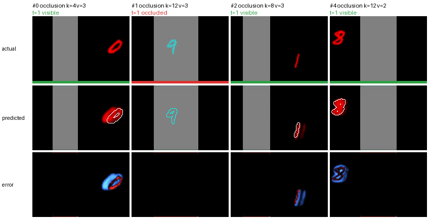
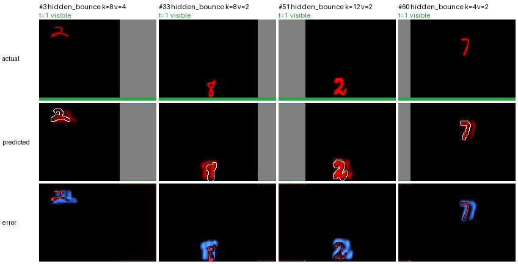
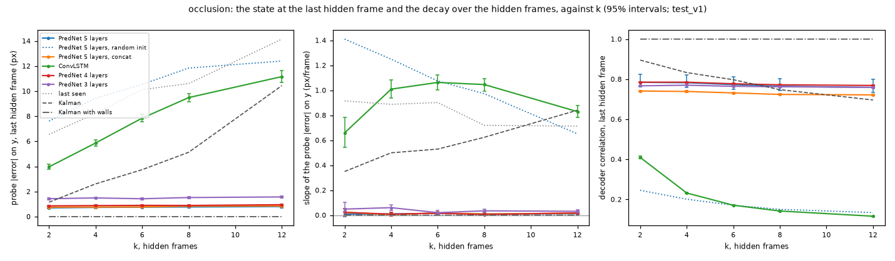
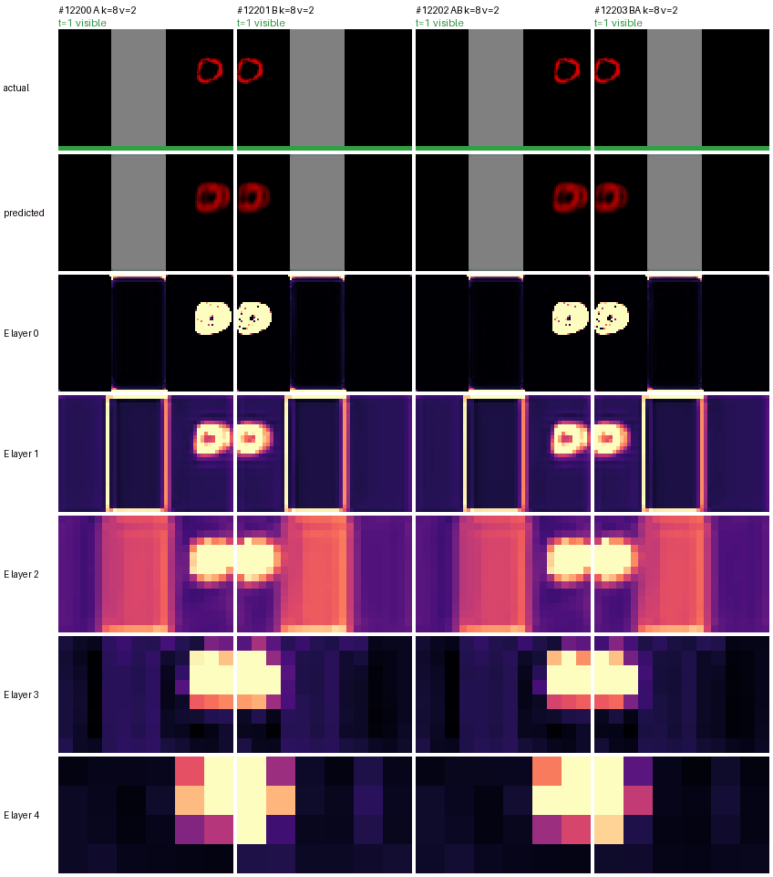
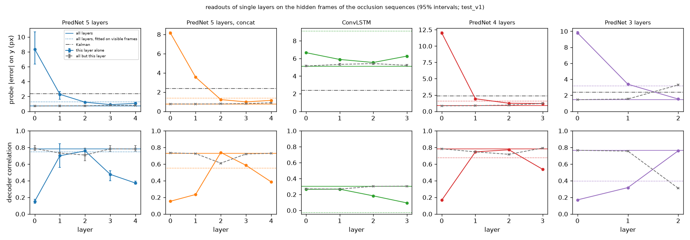
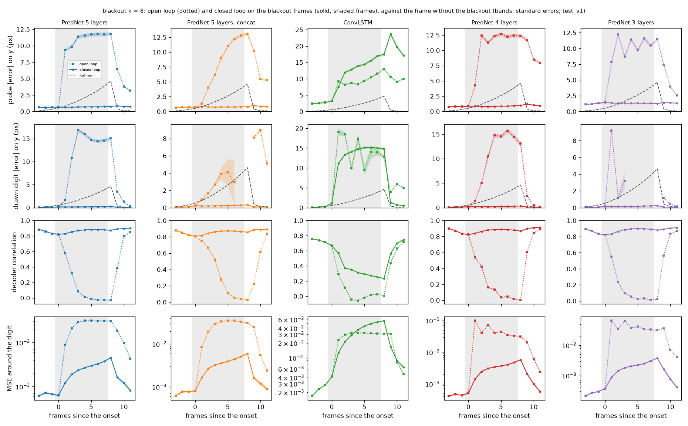

# Peekaboo: Do Predictive Coding Networks Keep Track of Hidden Objects?

Controlled occlusion benchmark and analysis of PredNet: tracking through occlusion, reappearance, and surprise.

<p align="center">
  
  
</p>
<p align="center"><sub>PredNet 5 layers, the reference model of the training sweep, on validation sequences: occlusion (left) and hidden bounce (right). For each sequence: the true frame (hidden ink in cyan); the prediction made before the frame arrives, with the true digit outlined, and what is read in the model's internal state, the position (yellow cross) and the digit itself (magenta); the prediction error.</sub></p>

A digit moves behind an occluder and reappears, as expected or in a surprising way. We measure what a predictive coding video model (PredNet) predicts during and after the occlusion, what its internal state still encodes about the hidden object, and how strongly its prediction errors react to surprising reappearances. The project provides:

- a synthetic occlusion generator with full ground truth (hidden positions, amodal frames, scripted surprises);
- a clean PyTorch PredNet, with ablations, a ConvLSTM baseline, and programmed trackers (Kalman filters);
- a measurement protocol, latent probes, and visualizations.

## Research questions

1. **Tracking through occlusion.** While the object is hidden, how fast does each model lose it? We read the answer both from the predicted frames and, with linear probes, from the model's internal state.
2. **Correction after reappearance.** How many frames does each model need to recover when the object comes back, for expected and for surprising reappearances?
3. **Surprise.** Are prediction errors larger after a surprising reappearance than after a matched plausible one? Surprise tests follow the violation of expectation design of PLATO (Piloto et al., 2022): impossible and possible sequences end with the same frames and differ only in their history.

A constant velocity Kalman filter is close to optimal on this synthetic motion. It serves as a reference, not as a competitor.

## Approach

- **Data.** A red MNIST digit moves on 64 x 96 frames and crosses a gray bar that hides it for exactly k frames. The conditions are a matched control (a bar too narrow to hide the digit), occlusion, a bounce off a wall while hidden, and a blackout of the input. Surprises are PLATO style tuples: two plausible sequences and their two impossible splices, cut while the digit is hidden, so the cut itself is invisible. Every frame comes with its exact ground truth, including the position of the hidden digit.
- **Models.** PredNet reimplemented in PyTorch from the paper, its ablations (depth, no explicit error units), a ConvLSTM baseline, and programmed trackers (detector, last seen position, Kalman filters).
- **Readouts.** What the model predicts (the frames above), where it believes the hidden digit is (a linear position probe on its internal state), and what it imagines behind the bar (an amodal decoder).

The details are in [docs/implementation.md](docs/implementation.md).

## Results

Before any occlusion analysis, a model must predict the next frame well: on frames where the digit is visible and moving, its error must be at least 30% below the better of two baselines, copying the last frame and the frame without its digit (gate D16). Next frame MSE on these frames of the validation set:

| Model | Training loss | MSE | Below the blank frame | Below the copy | Gate |
| --- | --- | --- | --- | --- | --- |
| copy of the last frame | | 0.00263 | | | |
| blank frame (digit erased) | | 0.00205 | | | |
| PredNet 5 layers | PredNet's own loss | 0.00205 | 0% | 22% | failed |
| PredNet 5 layers | visible digit pixels weighted by 10 | **0.00010** | **95%** | **96%** | passed |

With its own loss, PredNet learns the bar and the background perfectly but never draws the digit, which covers only 0.4% of the loss values. Weighting the visible digit pixels by 10 fixes it: the digit is drawn sharp and in place (SSIM 0.999), at every speed and in every condition. The first figures already point at tracking: the model draws the part of the digit that emerges from the bar, and brings a digit back at about the right time after a hidden bounce.

**The hidden digit stays in the model's state.** A linear probe reads the digit's position in PredNet's internal states. On fully hidden frames of the validation set, it finds the vertical position within **0.6 px**, as precisely as when the digit is visible (0.7 px), and the error does not grow over 15 hidden frames, even through a bounce off a wall while hidden. The same probe on an untrained PredNet is about 10 px off, no better than the last seen position.

A minimal decoder (one weight per state channel) also reads the hidden digit itself from the states: a blurred but well placed digit under the bar (correlation 0.74 with the true hidden digit, against 0.88 when visible and 0.16 for an untrained PredNet), which follows the digit through a hidden bounce.

**It holds across PredNet variants, not for the ConvLSTM.** The training sweep trains every model with the same settings (15k steps, about 3.1 million parameters each). On fully hidden frames of occlusion sequences of the validation set:

| Model | Gate D16: below the blank frame | Probe error on y, hidden | Decoder correlation, hidden |
| --- | --- | --- | --- |
| PredNet 5 layers | 97% | **0.64 px** | 0.75 |
| PredNet 4 layers | 98% | 0.88 px | **0.77** |
| PredNet 3 layers | **99%** | 1.54 px | 0.76 |
| PredNet 5 layers, without explicit error units | 85% | 0.76 px | 0.72 |
| ConvLSTM | 42% | 6.47 px | 0.22 |
| constant velocity Kalman filter (and the template it moves) | | 3.87 px | 0.81 |

Every PredNet keeps the hidden digit's position and shape in its state, and follows it through a bounce off a wall while hidden, where the Kalman filter goes the wrong way. Shallower PredNets predict the frames better but hold the position less precisely. The ConvLSTM, with the same budget, loses the digit once it goes behind the bar.

**On the test set, the PredNets do not lose the digit as the occlusion lasts (RQ1).** On 5600 occlusion sequences of the test set (95% bootstrap intervals; PredNet 5 layers with three training seeds, the other models with one):

| Model | Probe error on y, hidden | After 12 hidden frames | Digit drawn again on time |
| --- | --- | --- | --- |
| PredNet 5 layers (3 seeds) | **0.72 px** [0.64, 0.80] | **0.80 px** | 87% |
| PredNet 4 layers | 0.86 px [0.84, 0.87] | 0.95 px | 91% |
| PredNet 3 layers | 1.46 px [1.44, 1.49] | 1.57 px | **93%** |
| PredNet 5 layers, without explicit error units | 0.76 px [0.74, 0.77] | 0.85 px | 90% |
| ConvLSTM | 5.13 px [5.03, 5.22] | 11.16 px | 22% (71% one frame late) |
| constant velocity Kalman filter | 2.38 px [2.21, 2.54] | 10.44 px | |
| copy of the last frame | | | 0% (one frame late by construction) |

The PredNets' error grows by at most 0.06 px per hidden frame, and they draw the edge of the digit on the very frame it comes out of the bar, before they have seen any of it. The ConvLSTM loses about 1 px per hidden frame and, like the copy of the last frame, draws the digit one frame late.

<p align="center">
  
</p>

**After a surprising reappearance, the PredNets need a few frames to give up their expectation (RQ2).** Each impossible sequence of a surprise tuple is compared with a possible one that ends with exactly the same frames. After a reappearance on the wrong side, the 5 layer model draws the digit where it expected it, then in its new place about 3 frames later (2.8 frames more than on the same frames with an ordinary history, [2.6, 2.9]); after a 12 px offset, 2 frames later; after a timing surprise, 1. Its probe stays on the old trajectory longer still: about 17 px off over the next 6 frames, against 1.3 px on the identical control frames. The ConvLSTM draws the same frames whatever the history, one frame late as a copy would: with nothing expected, nothing surprises it.

**A surprising history raises the errors of the PredNets on identical frames, even when nothing appears (RQ3).** In nearly every tuple of every surprise kind, the error on the impossible sequence is above the error on the possible one that shows the same frames (AUROC 0.92 to 1.00; ConvLSTM, 0.50 to 0.53). The clearest case is a digit that never comes back: the frames do not change at all, and the 5 layer model's error still rises more than 100 fold around the frame where the digit should return, then fades. The same look with a wall to explain it costs far less: returning on the entry side raises the error about 1.6 fold after a hidden bounce and 4 fold without a wall.

<p align="center">
  
</p>
<p align="center"><sub>A surprise tuple of the test set, PredNet 5 layers: the two possible sequences (A, B) and their impossible splices (AB, BA), which end with the same frames as B and A. For each: the true frame, the prediction, and the error units of every layer, from the pixels (layer 0) to the top. On the impossible members, the model draws the digit where it expected it, and the errors rise in every layer.</sub></p>

**Inside the state, the hidden digit is held in the upper layers, coded nearly as a visible one.** Probes and decoders fitted on every layer alone show that the lowest layer, which predicts the pixels, loses the hidden digit (8 to 12 px off), while the upper layers each hold it (layer 3 of the 5 layer model alone: 0.9 px); in the 5 layer model, removing any one layer costs at most 0.08 px. A probe fitted on visible frames only, which never saw a hidden digit, still reads it within 1.3 px in the 5 layer model, better than the Kalman filter (2.4 px). After a surprise, the expectation is kept above the pixel layer, and while the digit is hidden, the error units of the upper layers stay at their visible level: holding the digit costs no error activity.

<p align="center">
  
</p>

**Without an occluder, the state lets go of the digit; on its own predictions, the model keeps it.** When the input goes black instead of being hidden by the bar, a situation never seen in training, every PredNet loses the digit, the 5 layer model after a single black frame: its probe is 6.9 px off over the blackout, about as far as the last seen position (6.4 px), while it stays within 0.72 px under the bar. Fed its own predictions in place of the black frames (closed loop), the same model keeps the digit for the whole blackout: its probe stays within 0.73 px, ahead of the Kalman filter (1.35 px), and the digit it draws is within 0.23 px of its true place. The ConvLSTM gets worse in closed loop.

<p align="center">
  
</p>

**Limits.** PredNet 5 layers was trained with three seeds and the other models with one, so differences of a few tenths of a pixel between models are differences between runs: the three seeds of the 5 layer model alone range from 0.64 to 0.80 px on the hidden digit, and one of them had its gradient explode late in training (kept, by a rule fixed beforehand). The data are synthetic: one digit, straight motion at constant speed, one gray bar. The ConvLSTM was trained with one budget, the PredNets', and its failure to track holds for that budget. The readouts are linear and show what the state holds, not how the model uses it.

Every number and figure is remade from the saved runs by one command (`python -m scripts.make_results`); the summary tables are in [runs/analysis/test_v1/summary/](runs/analysis/test_v1/summary/) and the full analysis is in [docs/experiments.md](docs/experiments.md).

## Status

| Phase | Content | State |
| --- | --- | --- |
| 1 | Occlusion generator, surprise tuples, ground truth, validation and test sets, PredNet | done |
| 2.1 to 2.9 | Training, evaluation, prediction figures, the pilot run of PredNet, its ablations (no explicit error units, 3 and 4 layers), the ConvLSTM baseline, the programmed trackers (Kalman filters), the position probe, and the amodal decoder | done |
| 2.10 | Training sweep of every model: PredNet with 3, 4, and 5 layers, without explicit error units, and the ConvLSTM | done |
| 3.1 to 3.6 | Development set, extraction pass over the test set, statistics, tracking through occlusion (RQ1), correction after the reappearance (RQ2), surprise (RQ3), inside the state (layers and error units), and blackout and closed loop | done |
| 3.7 | Seeds 1 and 2 of PredNet 5 layers, and every analysis again with the three seeds | done |
| 3.8 | Results: one script that remakes every result, summary tables, examples of every model, and the write-up | done |
| 4 | Harder synthetic data: blackouts during training, then several digits in a scene | planned |

The detailed status of every step is in [docs/implementation.md](docs/implementation.md#status).

## Quick start

```
mamba env create -f environment.yml
mamba activate peekaboo
python -m pytest

python -m scripts.prepare_mnist                                   # download MNIST, build the digit pools
python -m scripts.make_dataset --config configs/data/val_v1.yaml  # the validation set
PYTORCH_ENABLE_MPS_FALLBACK=0 python -m scripts.train --config configs/train/smoke.yaml  # one minute training run
python -m scripts.eval_next_frame --run runs/pilot_prednet5l_w10/seed0   # gate D16 of the pilot model
python -m scripts.show_predictions --run runs/pilot_prednet5l_w10/seed0  # its prediction figures
```

The code runs on CUDA, Apple GPUs (MPS), and CPU. The pilot model is included in the repository, so the last two commands need no training. Every command, with its options and expected output, is in [docs/usage.md](docs/usage.md).

## Repository layout

```
peekaboo/   the package: data generator, models, training, evaluation, figures
scripts/    command line entry points
configs/    one config file per dataset, model, and training run
tests/      unit tests (pytest)
docs/       implementation, usage, and experiments
runs/       the reference pilot run, the sweep comparison, and the test set analyses (other runs, data, and figures stay local)
```

The full tree is in [docs/implementation.md](docs/implementation.md#repository-layout).

## Documentation

- [Implementation](docs/implementation.md): the generator, the datasets, the models, training and evaluation, module by module.
- [Usage](docs/usage.md): setup and every command, with what it does and its expected result.
- [Experiments](docs/experiments.md): each training experiment, its results, and the decisions it led to.

## References

- R. P. N. Rao and D. H. Ballard. Predictive coding in the visual cortex. *Nature Neuroscience*, 1999.
- W. Lotter, G. Kreiman, and D. Cox. Deep predictive coding networks for video prediction and unsupervised learning. *ICLR*, 2017.
- R. Rane, E. Szügyi, V. Saxena, A. Ofner, and S. Stober. PredNet and predictive coding: a critical review. *ICMR*, 2020.
- X. Shi, Z. Chen, H. Wang, D.-Y. Yeung, W. Wong, and W. Woo. Convolutional LSTM network: a machine learning approach for precipitation nowcasting. *NeurIPS*, 2015.
- N. Srivastava, E. Mansimov, and R. Salakhutdinov. Unsupervised learning of video representations using LSTMs. *ICML*, 2015.
- L. S. Piloto, A. Weinstein, P. Battaglia, and M. Botvinick. Intuitive physics learning in a deep-learning model inspired by developmental psychology. *Nature Human Behaviour*, 2022.
- A. Shamsian, O. Kleinfeld, A. Globerson, and G. Chechik. Learning object permanence from video. *ECCV*, 2020.
- M. Traub, F. Becker, S. Otte, and M. V. Butz. Learning object permanence from videos via latent imaginations. *ICANN*, 2024.

This project reimplements PredNet from the paper and uses the original code and OpenSTL as read only references. See [THIRD_PARTY_NOTICES.md](THIRD_PARTY_NOTICES.md).

## License

The code of this project is released under the [MIT License](LICENSE). Third party references keep their own licenses.
