# Experiments

The lab notebook of the project: each training experiment, what it showed, and the decisions it led to, in the order they were run. How the code works is in [implementation.md](implementation.md), and the commands that reproduce each run are in [usage.md](usage.md).

## Step 2.4: pilot training of PredNet 5 layers

**First pilot: PredNet's own loss fails.** PredNet 5 layers, 10k steps of 16 sequences of 40 frames (`configs/train/pilot_prednet5l.yaml`). The loss fell below the plateau where only the bar is known, but from step 3500 on the validation MSE stayed at 0.00149, the MSE of the blank frame (the true frame with its digit erased, 0.00148). The learning rate drop at step 5000 did not change it. The prediction figures show a perfect bar and background, and no digit at all. On the visible moving frames of `val_v1`, the MSE was 0.00205 against 0.00205 for the blank frame and 0.00263 for the copy: the gate D16 failed.

The cause is the sparsity of the digit in the loss. The red digit covers about 1.2% of the pixels, on one channel out of three, so about 0.4% of the loss values, against about 7% in the usual Moving MNIST (two white 28 px digits on 64 x 64 frames), where PredNet learns to draw digits. With an L1 loss, a pixel that is unlikely to hold ink is best predicted empty: as long as the model cannot place the digit to the pixel, erasing it costs less than drawing it, and the model settled there.

**Two fixes, tried for 2000 steps each** (`scripts/trial_pilots.py`, same initialization and training sequences, constant learning rate):

| Variant | Validation MSE at step 2000 | Blank frame | Below the blank frame |
| --- | --- | --- | --- |
| first pilot, for comparison | 0.00161 | 0.00148 | -9% (then 0%) |
| white digit (three channels), PredNet's own loss | 0.00446 | 0.00444 | -0.5% |
| red digit, visible digit pixels weighted by 10 | 0.00063 | 0.00148 | +57% (13%, 40%, 51%, 57% at steps 500 to 2000) |

A white digit, three times heavier in the loss, still settled on the blank solution. The weighted loss drew the digit within 500 steps, sharp and in the right place, and after only 2000 steps passed the gate D16 by far: on the visible moving frames, an MSE 72% below the blank frame and 78% below the copy, at every speed, in every condition, and for every k (59% below the blank frame at k = 12). The drawn digit is slightly thicker than the true one, as expected when missing ink costs ten times more than extra ink.

**Decision (D12).** Every learned model trains with the visible digit pixels weighted by 10 (`loss.digit_weight: 10`). The weight changes only the training objective, uses only ink visible in the target frame, and gives no information about a hidden digit.

**Full pilot with the weighted loss: the gate passes by far.** Same settings as the first pilot, with the digit weight of 10 (`configs/train/pilot_prednet5l_w10.yaml`, 10k steps, about 5 h 30 on an Apple M5). On the visible moving frames of `val_v1`, the best checkpoint (step 10000) has an MSE of 0.00010, 95% below the blank frame (0.00205) and 96% below the copy (0.00263), with an SSIM of 0.999. The reduction against the blank frame is between 94% and 96% in every condition, at every speed, and for every k, so PredNet does not fall back to copying on fast digits.

| Step | 500 | 1000 | 2000 | 3000 | 4000 | 4500 | 5000 | 6000 | 8000 | 10000 |
| --- | --- | --- | --- | --- | --- | --- | --- | --- | --- | --- |
| Validation MSE (all frames, blank frame 0.00148) | 0.00129 | 0.00089 | 0.00063 | 0.00053 | 0.00038 | 0.00017 | 0.00016 | 0.00014 | 0.00014 | 0.00013 |

The validation MSE fell by half between steps 4000 and 4500, a sudden change in what the model had learned, 500 steps before the learning rate drop. After the drop, it improved only slowly. With another seed or another model, such a change could come after the drop, and much later with a learning rate ten times smaller: the training sweep (step 2.10) should therefore keep the high learning rate longer, for example 15k steps with the drop at 10k, and check that every run has passed this change before its drop.

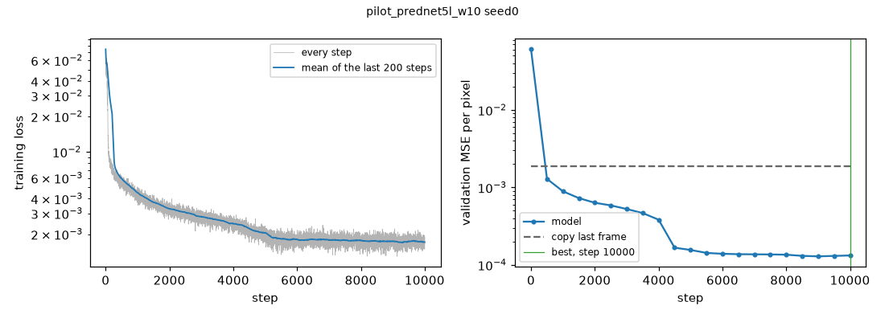

Training loss and validation MSE of the weighted pilot, against copying the last frame.

The prediction figures show the digit drawn sharp and in place on every visible frame, and nothing under the bar, which is the correct prediction of the next frame there. Two examples already point at tracking. In an occlusion sequence, the model draws the part of the digit that comes out at the edge of the bar in the first frame of the reappearance, from frames in which the digit was fully hidden. In a hidden bounce sequence, it draws the digit coming back out on the side it entered, at about the right time. Phase 3 measures this on the whole test set.

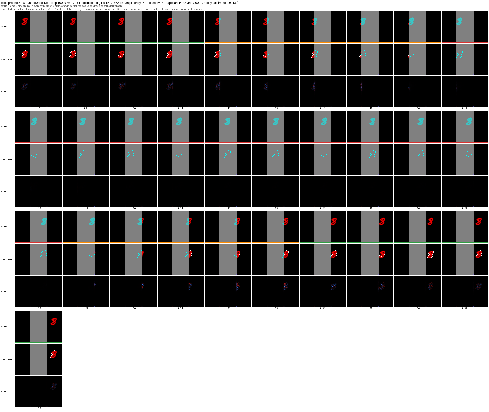

Frames around a crossing of `val_v1`: the true frame (hidden ink in cyan), the prediction with the outline of the true digit, and the pixel error (red: missed, blue: extra).

The run is kept in git as the reference result of step 2.4: `runs/pilot_prednet5l_w10/` (settings, logs, curves, `best.pt`, evaluation, and prediction figures) and its output `runs/pilot_prednet5l_w10.log`.

## Step 2.8: position probe on the pilot model

**Question.** While the digit is fully hidden, the correct next frame shows only the bar, so the predicted frames cannot tell whether PredNet still knows where the digit is. The position probe reads it in the model's internal state instead (option B, decision D15): a linear readout of the centroid from the pooled states R, fitted on the frozen pilot model (`runs/pilot_prednet5l_w10`, step 10000).

**Setup** (`scripts/fit_probes.py`, about 9 minutes). Features: the five layers of R, average pooled to 5,760 values per frame. Probes fitted on the analysis windows of 800 new sequences of the training stream (20,059 frames, hidden frames included), penalties chosen on held out training sequences (ridge alpha 100, logistic C 0.01). Evaluation on the 1000 sequences of `val_v1`, digits never seen in training. Controls: the same probe on the same architecture at random initialization, the programmed trackers of step 2.7, and the bar center for x.

**Result: the state keeps the hidden digit's position almost as precisely as a visible one.** Mean absolute error in pixels on the fully hidden frames of the analysis window (y is the main axis, critique C4):

| Method | occlusion, y | occlusion, x | hidden bounce, y | hidden bounce, x |
| --- | --- | --- | --- | --- |
| probe of the trained PredNet | **0.60** | **0.59** | **0.81** | **1.37** |
| probe of PredNet at random initialization | 9.66 | 5.08 | 9.14 | 6.25 |
| last seen position | 8.88 | 25.79 | 9.47 | 19.67 |
| Kalman, constant velocity | 3.87 | 0.12 | 3.85 | 6.68 |
| Kalman with walls (exact reference) | 0.00 | 0.00 | 0.00 | 0.00 |
| bar center | | 6.31 | | 3.34 |

- On fully hidden frames, the probe's error (0.60 px in y) equals its error on visible frames (0.68 px): hiding the digit costs the state almost no position information.
- The error stays flat over the first 15 hidden frames (figure below), while the last seen position and the constant velocity filter drift away. The state does not just hold the last position: it updates it as the digit moves behind the bar.
- After a bounce off the wall while hidden, the probe still finds the digit (1.4 px in x), where the constant velocity filter is 6.7 px off on average and about 37 px after 15 frames. The state follows the bounce.
- The probe beats the constant velocity filter even in y, where the filter is hurt by vertical bounces just before or under the bar.
- The random initialization control reads the visible digit roughly (4 to 5 px) but loses it once hidden (9 to 10 px, close to the last seen position): the position code of hidden digits comes from training, not from the architecture.
- The 8 bin probe agrees: the probability of the true bin of y is 0.87 on hidden frames of occlusions (0.25 at random initialization, 0.125 by chance).

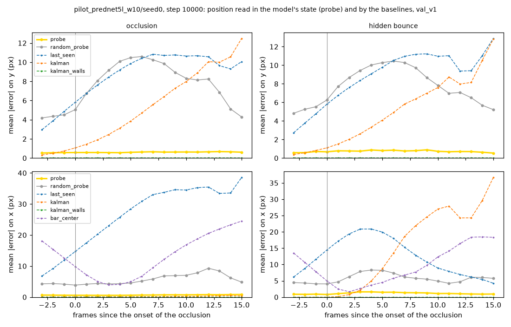

Mean absolute error on y (top) and x (bottom) against the frames since the onset of the occlusion, for occlusion (left) and hidden bounce (right) sequences of `val_v1`. The probe of the trained model (yellow) stays flat at about 0.6 px.

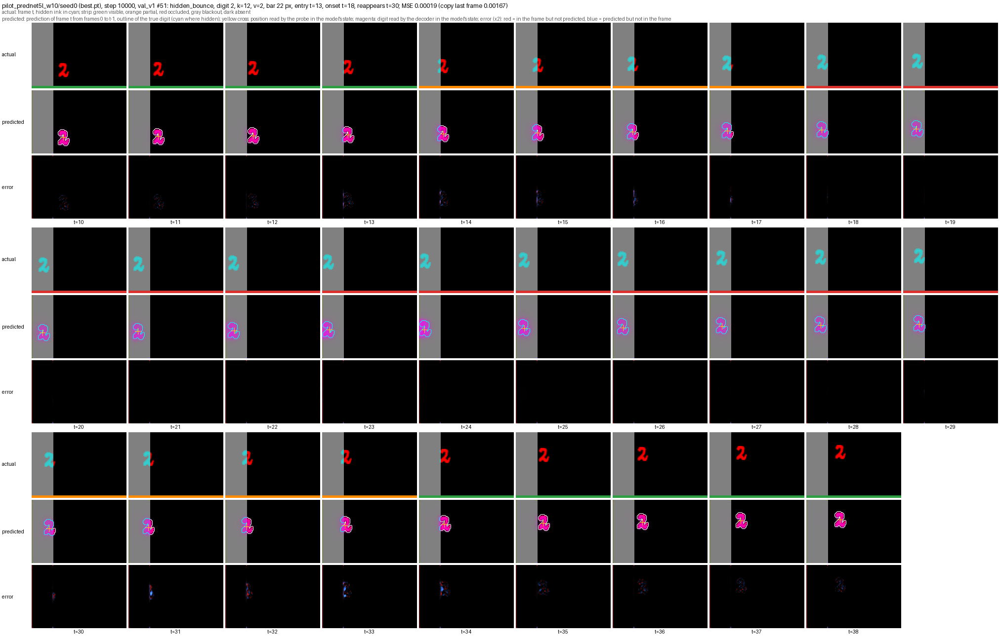

A hidden bounce of `val_v1` (k = 12, 2 px/frame): the yellow cross, where the probe reads the digit in the state, follows the hidden digit (cyan outline) to the wall and back, through 12 fully hidden frames.

**Limits.** One seed, one model, and the validation set. The probe is trained with hidden frames, so it shows that the information is in the state in a linearly readable form, not that the model uses it the same way as for visible digits. Phase 3 measures this on `test_v1` per k, speed, and condition (blackouts included), on every model of the sweep, and can test whether a probe trained on visible frames only transfers to hidden ones.

## Step 2.9: amodal decoder on the pilot model

**Question.** The position probe reads a point. Does the state also hold the hidden digit itself, its shape, at its place under the bar? The amodal decoder (option C) reads the whole digit from the frozen states: each layer's state goes through a 1 x 1 convolution, upsampled to the frame and summed, then a sigmoid, trained to output the amodal frame (the digit as if there were no bar). With 244 parameters, one per state channel, it cannot draw a digit by itself: a shape appears only where the state holds one.

**Setup** (`scripts/fit_decoder.py`, about 6 minutes). Training on 400 batches of 8 new sequences of the training stream (analysis windows, ink pixels weighted by 10). Evaluation on the 1000 sequences of `val_v1`, per frame: the ink IoU and the correlation between the decoded and the true amodal digit. Controls: the same decoder at random initialization, and the last fully visible digit copied and moved by the constant velocity Kalman filter (`template_kalman`) or by the exact filter with walls (`template_walls`, the ceiling).

**Result: the state holds a blurred but well placed image of the hidden digit.** Mean scores on the analysis window:

| Method | occlusion, IoU | occlusion, correlation | hidden bounce, IoU | hidden bounce, correlation |
| --- | --- | --- | --- | --- |
| decoder, fully hidden frames | **0.42** | **0.74** | **0.41** | **0.70** |
| decoder, visible frames (its own ceiling) | 0.63 | 0.88 | 0.66 | 0.89 |
| decoder at random initialization, hidden | 0.00 | 0.16 | 0.00 | 0.20 |
| template moved at constant velocity, hidden | 0.73 | 0.81 | 0.44 | 0.55 |
| template moved with walls (exact), hidden | 1.00 | 1.00 | 1.00 | 1.00 |

- The minimal decoder cannot reproduce even a visible digit sharply (IoU 0.63): its 1 x 1 readout of states that are coarse in the upper layers gives a blurred digit. On fully hidden frames it keeps about two thirds of that (IoU 0.42, correlation 0.74 against 0.88): a digit shaped blob at the right place, which the figures show as a magenta glow inside the cyan outline under the bar.
- At random initialization, the same decoder finds nothing under the bar (IoU 0.00): the hidden digit in the state comes from training.
- When the motion is constant, a template with the exact shape moved at constant velocity does better (IoU 0.73): the decoder's limit is the sharpness of the readout, not the place. After a bounce while hidden, the constant velocity template goes the wrong way (correlation 0.55, down to 0.1 about 7 frames after the onset) while the decoder stays at 0.70: the imagined digit follows the bounce, as the position probe did.
- In the curves against the frames since the onset, the decoder drops at the onset (0.60 to 0.42) and rises again later. The later frames mix values of k: for short occlusions the digit is already reappearing there, so the rise does not mean the hidden digit gets sharper.

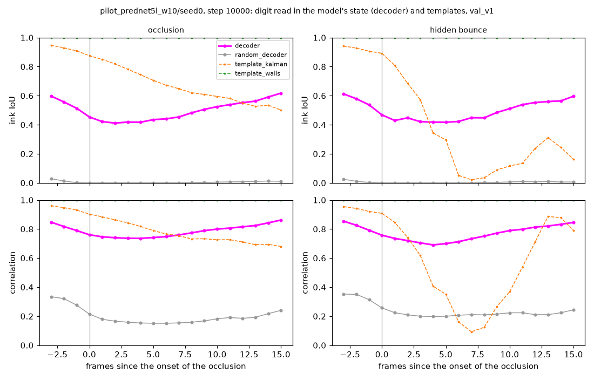

Ink IoU (top) and correlation (bottom) between the decoded and the true amodal digit against the frames since the onset of the occlusion, for occlusion (left) and hidden bounce (right) sequences of `val_v1`.

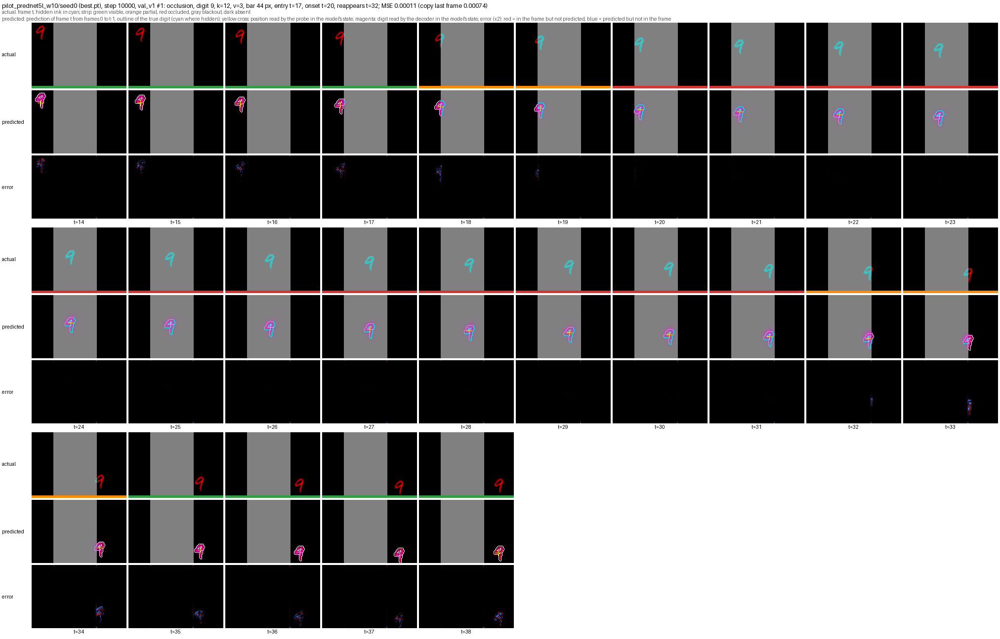

An occlusion of `val_v1` (k = 12, 3 px/frame) with both readouts on the predicted row: the yellow cross (probe) and the magenta digit (decoder) move under the bar with the true digit (cyan outline) for 12 fully hidden frames.

**Limits.** One seed and the validation set, as for the probe. The decoder is minimal on purpose, so its scores are a lower bound of what the state holds; a larger kernel (`--kernel`) would read more, but could also draw shapes by itself. The scores per k, and per layer, are left to Phase 3.

## Step 2.10: training sweep

**Question.** Does the pilot's result hold for other architectures? The sweep trains PredNet with 3, 4, and 5 layers (depth), PredNet 5 layers without explicit error units (concat: the layers pass on their states instead of their errors), and a ConvLSTM without any predictive coding structure, all at about 3.1 million parameters (within 10% of each other).

**Setup.** Five configs identical except for the model (`configs/train/sweep_*.yaml`): seed 0, 15k steps of 16 sequences of 40 frames, visible digit pixels weighted by 10, Adam at 0.001 divided by 10 at step 10000 (so that the sudden change of the pilot has time to happen before the drop), gradient norm clipped at 1.0, validation on the whole `val_v1` every 500 steps. One run at a time on an Apple M5, followed with `scripts/sweep.py`, each followed by the gate D16, the position probes, the amodal decoder, and the figures. Training took about 87 h: 7.4 h for 5 layers, 7.6 h for concat, 14.7 h for the ConvLSTM, 13.8 h for 4 layers (plus 14.0 h for its failed seed 0 run), and 29.1 h for 3 layers. The tables below come from `scripts/compare_sweep.py` (`runs/sweep_summary/summary.csv`).

**PredNet 4 layers with seed 0 failed, and was rerun with seed 1.** From step 100 on it stayed on the blank frame (training loss 0.0110 against 0.0087 for 5 layers), while its gradient norm shrank to 0.014. At steps 3967 to 3973 the gradient exploded (norms 3.6, then 835, then 1.3e4; there was no clipping then), and the predictions stayed black for 10k steps before a partial recovery. Its best checkpoint is the blank model of step 3500 (gate 0%, probe as at random initialization). The run is kept in `runs/sweep_prednet4l/seed0/` as a record. Gradient clipping at 1.0 was then added to every sweep config: the norm never exceeded 0.31 in the three runs already trained (5 layers, concat, ConvLSTM), so the clip would not have changed them, and they were not retrained (their saved `config.yaml` says `grad_clip: null`). PredNet 4 layers was rerun with seed 1, and the 4 and 3 layer runs were checked at step 1000: their validation MSE was 67% and 77% below the blank frame (at least 25% required).

**Two later loss spikes recovered by themselves.** In PredNet 4 layers seed 1, the training loss rose from 0.0014 to 0.008 between steps 9300 and 9313 and the validation MSE doubled at step 9500, back to its level by step 10000. In PredNet 3 layers, the same happened at step 6705, back by step 7500. In the 4 layer run the gradient norm stayed below 0.25 during the spike, and the clip never acted in the whole run (largest norm 0.73, at step 27); in the 3 layer run it acted once, at the spike (norm 1.77). These are not gradient explosions. The likely cause is Adam itself: when the gradients become very small, its normalized steps stay large. Both best checkpoints are from step 15000, after the recovery.

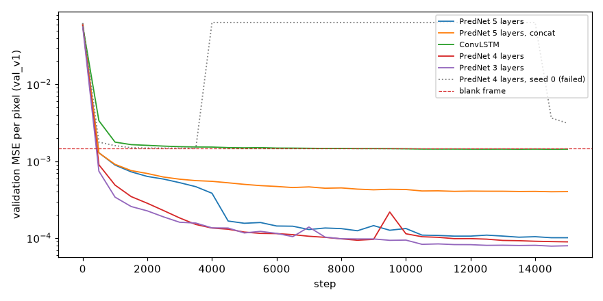

Validation MSE on `val_v1` of every sweep run against the training step, with the blank frame (dashed red) and the failed PredNet 4 layers seed 0 run (dotted).

Only the 5 layer model shows the pilot's sudden change (its validation MSE halves between steps 4000 and 4500). The 4 and 3 layer models get there smoothly, and faster: they reach the same level by step 3500.

**Next frame prediction: every PredNet passes the gate by far, the ConvLSTM barely.** Best checkpoints (step 15000, except the failed run), validation set:

| Model | Validation loss | Validation MSE (all frames) | Gate: below the blank frame (visible moving frames) | Gate at k = 12 |
| --- | --- | --- | --- | --- |
| PredNet 5 layers | 0.00141 | 0.00010 | 97% | 97% |
| PredNet 4 layers (seed 1) | 0.00119 | 0.00009 | 98% | 98% |
| PredNet 3 layers | **0.00095** | **0.00008** | **99%** | **99%** |
| PredNet 5 layers, concat | 0.00161 | 0.00040 | 85% | 74% |
| ConvLSTM | 0.00282 | 0.00144 | 42% | -1% |
| PredNet 4 layers, seed 0 (failed, step 3500) | 0.00988 | 0.00148 | 0% | 0% |
| blank frame | | 0.00148 | | |

- The three PredNet depths are within 3% of each other on the gate, at every speed, in every condition, and for every k. The shallower the model, the lower the loss: 3 layers predict the frames best, but take about 4 times longer to train than 5 layers (7.0 against 1.8 s per step).
- The 5 layer run follows the pilot (same seed and settings until the pilot's drop at step 5000) and was flat over the 2000 steps before its drop. The concat run never made the pilot's sudden change: its validation MSE stayed 4 times higher, flat from step 8500.
- The concat model draws the digit well in control sequences (94% below the blank frame) but less well in sequences with a crossing, and the longer the occlusion, the worse (90% at k = 2, 74% at k = 12). The visible frames of these sequences include those after the reappearance: without explicit errors, PredNet seems slower to pick the digit up again.
- The ConvLSTM barely leaves the blank frame (validation MSE 3% below it). It passes the gate overall only through the control sequences (79% below the blank frame); with a crossing it is 15% below in occlusion sequences, and no better than the blank frame at k = 12 (-1%). It draws a moving digit, but loses it once it has gone behind the bar.

**Readouts: every PredNet keeps the hidden digit, the ConvLSTM does not.** Analysis windows of `val_v1`, fully hidden frames unless marked visible; errors in px:

| Model | Probe y, occlusion | Probe y, visible | Probe x, occlusion | Probe x, hidden bounce | True y bin probability | Decoder correlation, occlusion | Decoder IoU, occlusion | Decoder correlation, hidden bounce |
| --- | --- | --- | --- | --- | --- | --- | --- | --- |
| PredNet 5 layers | **0.64** | **0.74** | **0.64** | **1.20** | **0.88** | 0.75 | 0.45 | 0.72 |
| PredNet 4 layers (seed 1) | 0.88 | 0.90 | 0.78 | 2.41 | 0.84 | **0.77** | **0.47** | **0.75** |
| PredNet 3 layers | 1.54 | 1.20 | 1.40 | 3.23 | 0.69 | 0.76 | 0.41 | 0.73 |
| PredNet 5 layers, concat | 0.76 | 0.80 | 0.65 | 1.67 | 0.87 | 0.72 | 0.42 | 0.69 |
| ConvLSTM | 6.47 | 2.48 | 3.38 | 5.87 | 0.41 | 0.22 | 0.00 | 0.25 |
| same model at random initialization | 8.9 to 10.2 | | | | 0.25 to 0.27 | 0.14 to 0.17 | 0.00 | 0.19 to 0.21 |
| last seen position | 8.88 | | 25.79 | 19.67 | | | | |
| Kalman, constant velocity (and the template it moves) | 3.87 | | 0.12 | 6.68 | | 0.81 | 0.73 | 0.55 |

- **The pilot's result holds for every PredNet.** With 3, 4, or 5 layers, with or without explicit errors, the probe finds the hidden digit within 0.6 to 1.5 px in y, better than the constant velocity filter (3.9 px), and follows a hidden bounce (1.2 to 3.2 px in x, against 6.7 px for the filter and 19.7 px for the last seen position). The decoder reads a well placed hidden digit (correlation 0.72 to 0.77) and beats the template moved at constant velocity after a hidden bounce (0.69 to 0.75 against 0.55). At random initialization, none of them holds anything under the bar.
- **Depth trades pixels for position.** Fewer layers predict the frames better, but the position is less linearly readable: 0.64, 0.88, then 1.54 px in y for 5, 4, and 3 layers. Part of it is the readout: the shallower models have fewer pooled features (5,760, 4,224, and 3,168), and their error on visible frames grows too (0.74, 0.90, 1.20 px). But hiding the digit costs the 3 layer model more: its hidden error is 1.28 times its visible error, against 0.86 and 0.98 for 5 and 4 layers. The decoder does not change with depth (0.75 to 0.77).
- **Explicit errors help the prediction more than the memory.** The concat model's state keeps the hidden digit almost as well as the 5 layer PredNet (0.76 against 0.64 px; 0.72 against 0.75 for the decoder), although it predicts the frames 4 times worse: the hidden digit is in its state, but it is slower to draw it again after the reappearance.
- **The ConvLSTM does not track the hidden digit.** Its probe reads the visible digit at 2.5 px but the hidden one at 6.5 px, between the constant velocity filter and random initialization, and its decoder finds nothing under the bar (IoU 0.00, correlation 0.22 against 0.17 at random initialization). Its states are all at 16 x 24 (4 x 4 patches), so its readouts are coarser than PredNet's, whose first layer is at full resolution; the contrast between its own visible and hidden frames does not depend on that. With one seed and 15k steps, this shows that it did not learn to track with this budget, not that it cannot.

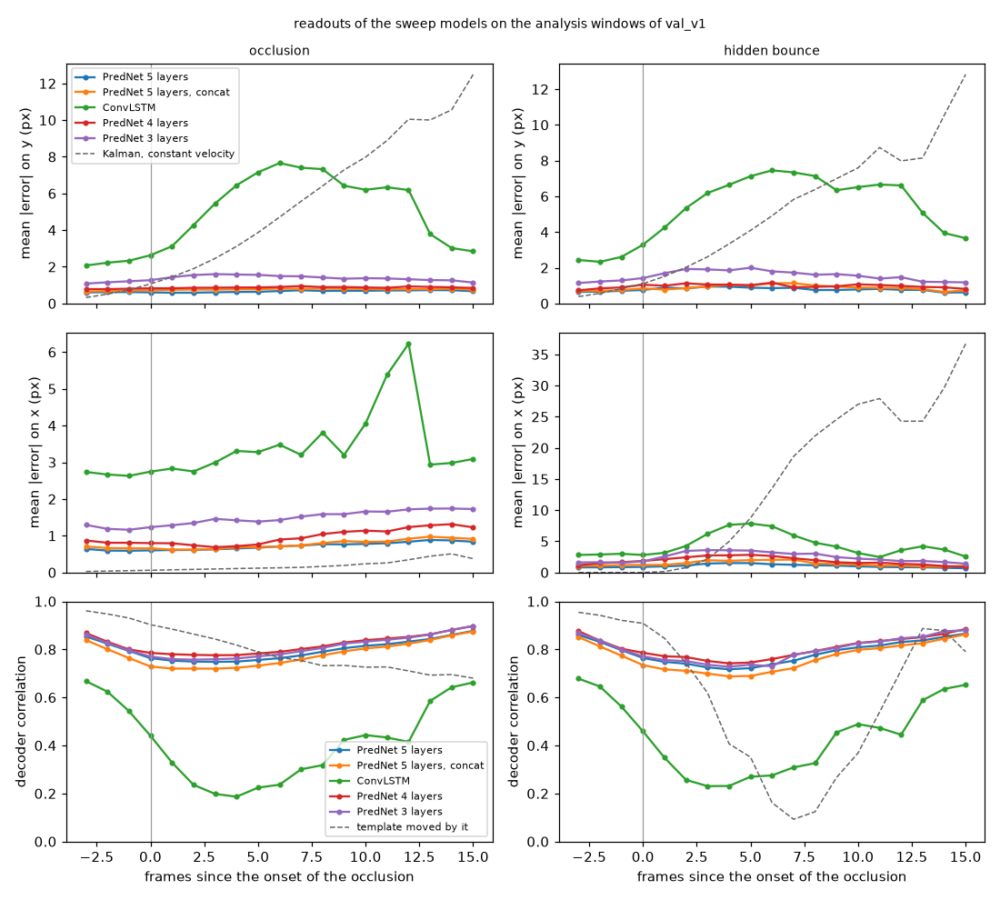

Probe error on y (top) and x (middle) and decoder correlation (bottom) against the frames since the onset of the occlusion, for occlusion (left) and hidden bounce (right) sequences of `val_v1`, one line per model, with the constant velocity Kalman filter and the template it moves (dashed gray). The later frames mix values of k: for short occlusions the digit is already reappearing there.

- Every PredNet stays flat over 15 hidden frames, in y and through hidden bounces, while the constant velocity filter drifts (12 px in y, 37 px in x after a hidden bounce). The x error of the 4 and 3 layer models grows slowly in occlusions (from 0.7 to 1.3 px and from 1.2 to 1.8 px), that of the 5 layer model much less.
- The PredNet decoders lose a little at the onset and stay near 0.75; the template moved at constant velocity starts higher but falls below them about 6 frames after the onset in occlusions, and down to 0.1 after hidden bounces.
- The ConvLSTM's error grows from the onset (from 2.6 to 7.7 px in y after 6 frames) and its decoder falls to 0.2: it forgets the digit within a few frames. Its later recovery comes from the digits that already reappear.

**Limits.** One seed per model (seed 1 for 4 layers), and the validation set: differences of a few tenths of a pixel or a few hundredths of correlation between the PredNets are not tested, and one 4 layer seed out of two failed to learn. The ConvLSTM's failure may depend on its budget. Phase 3 evaluates every model on `test_v1`: occlusion curves per k, correction after the reappearance, and surprise.

**Reference model.** PredNet 5 layers stays the reference model, shown in the README: it has the most precise readouts (best probe in every column, decoder within 0.03 of the best), it is the fastest to train (7.4 h, against 13.8 h for 4 layers and 29.1 h for 3 layers), it trained without incident with the first seed tried, and it is the architecture of Lotter et al. whose top layer sees the whole frame. The 3 layer model predicts the frames best, but the occlusion questions are about what the state holds, not about the pixels.

**Decisions.** The five models go to Phase 3 as trained here, with PredNet 4 layers seed 1 as its run of record. Gradient clipping at 1.0 stays in the configs; if more seeds are trained, a learning rate warmup or a larger Adam epsilon would address the spikes. The runs stay local (about 38 MB per checkpoint); the comparison is kept in git in `runs/sweep_summary/`.

## Step 3.2: tracking through occlusion (RQ1)

**Question.** While the digit is hidden, does each model keep it, and does it lose it faster when it stays hidden longer (H1b)? And does the model draw the digit again at the right frame and in the right place when it comes out (H1a)? A hidden digit is not to be drawn, so the predicted frames say something only when the digit comes out; what the model holds while it is hidden is read from its state, with the position probe and the amodal decoder.

**Setup.** The five sweep models (one seed each, seed 1 for 4 layers) on `test_v1`: the 5600 sequences of the occlusion cells (k = 2, 4, 6, 8, 12; the members of surprise tuples are left to RQ2 and RQ3) and the 2400 hidden bounce sequences (k = 4, 8). Each model ran once over the set (step 3.1, about 8 h for the five models), and `scripts/analyze_occlusion.py` reads the saved frames (`runs/analysis/test_v1/occlusion/`). Every value is first averaged per sequence; intervals are 95% percentile bootstraps over sequences (2000 resamples), and comparisons are paired on the same sequences. Every choice (the frames shown, the emergence window and threshold, the measures) was fixed on `dev_v1` and committed before `test_v1` was run.

One reading was fixed on `dev_v1` before that. The concat model and the ConvLSTM tint the whole gray bar slightly red on every frame (10 to 50 pixels' worth of ink), which pulled the centroid of the drawn digit toward the bar: 5 px of error even on visible frames, against 0.1 px for the PredNets. Since the bar is opaque, the true digit is never visible on it, so the centroid is now read off the bar (extraction format 2), and the five passes were written again.

**The hidden digit stays in every PredNet's state, not in the ConvLSTM's.** Hidden frames, all k together:

| Model | Probe error on y (px) | Probe error on x (px) | Decoder correlation | Probe error on y, minus the Kalman filter's |
| --- | --- | --- | --- | --- |
| PredNet 5 layers | **0.64** [0.63, 0.65] | **0.65** [0.65, 0.67] | 0.76 | **-1.74** [-1.90, -1.58] |
| PredNet 5 layers, concat | 0.76 [0.74, 0.77] | 0.70 [0.69, 0.71] | 0.73 | -1.62 [-1.78, -1.45] |
| PredNet 4 layers | 0.86 [0.84, 0.87] | 0.79 [0.78, 0.80] | **0.78** | -1.52 [-1.69, -1.35] |
| PredNet 3 layers | 1.46 [1.44, 1.49] | 1.35 [1.33, 1.37] | 0.76 | -0.92 [-1.08, -0.75] |
| ConvLSTM | 5.13 [5.03, 5.22] | 3.51 [3.46, 3.56] | 0.30 | 2.75 [2.57, 2.94] |
| same models at random initialization | 7.3 to 9.0 | | 0.17 to 0.20 | |
| last seen position | 7.77 | 21.96 | | |
| Kalman, constant velocity (and the template it moves) | 2.38 | 0.08 | 0.84 | |

Hidden bounce sequences, where the digit bounces off a wall behind the bar and comes back out on its entry side:

| Model | Probe error on y (px) | Probe error on x (px) | Decoder correlation | Decoder, minus the Kalman template |
| --- | --- | --- | --- | --- |
| PredNet 5 layers | **0.98** | **1.52** | 0.72 | +0.19 [0.18, 0.20] |
| PredNet 5 layers, concat | 1.13 | 1.88 | 0.69 | +0.16 [0.15, 0.16] |
| PredNet 4 layers | 1.23 | 2.67 | **0.75** | **+0.21** [0.21, 0.22] |
| PredNet 3 layers | 2.07 | 3.33 | 0.73 | +0.19 [0.18, 0.20] |
| ConvLSTM | 5.86 | 4.69 | 0.31 | -0.22 [-0.23, -0.21] |
| last seen position | 7.57 | 17.89 | | |
| Kalman, constant velocity (and the template it moves) | 2.55 | 4.50 | 0.54 | |

The Kalman filter with walls has no error at all (0.00 px): with exact positions and the walls known, it reproduces the motion exactly. It is the ceiling of the task, not a competitor.

- Every PredNet reads the hidden digit's vertical position within 0.6 to 1.5 px, 0.9 to 1.7 px better than the constant velocity filter, whose error comes from wall bounces just before or during the occlusion. Through a hidden bounce, they keep both axes (1.5 to 3.3 px in x, against 4.5 px for the filter and 17.9 px for the last seen position), and their decoders beat the template moved at constant velocity by about 0.2.
- In plain occlusions the template moved by the Kalman filter is still a better picture of the hidden digit (0.84 against 0.73 to 0.78): it is the true digit's own image, moved to a nearly exact position.
- The order of the sweep holds on the test set, now with intervals: against the 5 layer model, the probe error on y is 0.12 px larger for concat [0.11, 0.13], 0.22 px for 4 layers [0.20, 0.24], and 0.83 px for 3 layers [0.80, 0.85].
- The ConvLSTM's state holds less than a constant velocity filter (2.75 px worse), and its decoder is 0.11 above its own random initialization.

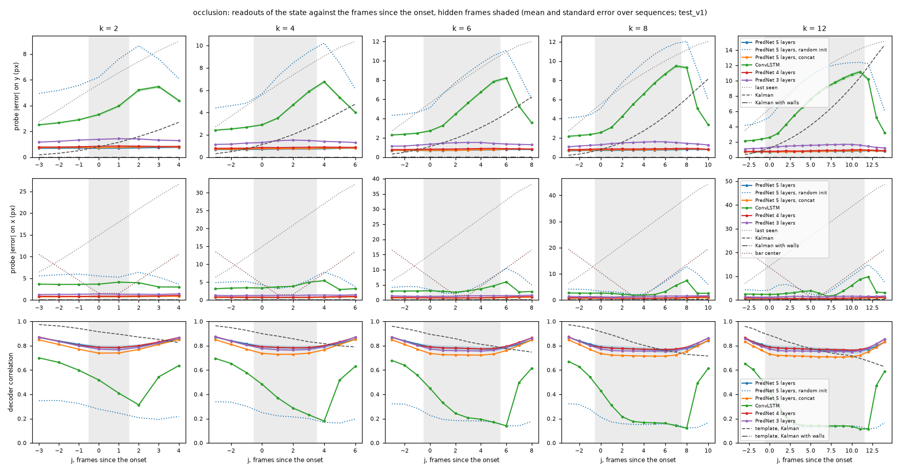

Occlusion sequences of `test_v1`: probe error on y (top) and x (middle) and decoder correlation (bottom) against j, the frames since the onset, one column per k, hidden frames shaded. Each model with its standard error band, the random initialization of the 5 layer model (dotted blue), and the references in gray: last seen position, Kalman filters, bar center, and the templates they move.

**H1b: the PredNets do not lose the digit as the occlusion lasts; the ConvLSTM loses it at once.** The slope of the probe error on y over the hidden frames, and its value at the last hidden frame:

| Model | Slope (px per hidden frame), k = 2 to 12 | Last hidden frame, k = 2 | Last hidden frame, k = 12 |
| --- | --- | --- | --- |
| PredNet 5 layers | 0.004 to 0.011 | 0.65 | **0.71** |
| PredNet 5 layers, concat | 0.004 to 0.024 | 0.76 | 0.85 |
| PredNet 4 layers | 0.005 to 0.023 | 0.86 | 0.95 |
| PredNet 3 layers | 0.020 to 0.060 | 1.43 | 1.57 |
| ConvLSTM | 0.66 to 1.06 | 3.97 | 11.16 |
| PredNet 5 layers at random initialization | 0.65 to 1.41 | 7.61 | 12.40 |
| last seen position | 0.71 to 0.92 | 6.55 | 14.14 |
| Kalman, constant velocity | 0.35 to 0.84 | 1.15 | 10.44 |

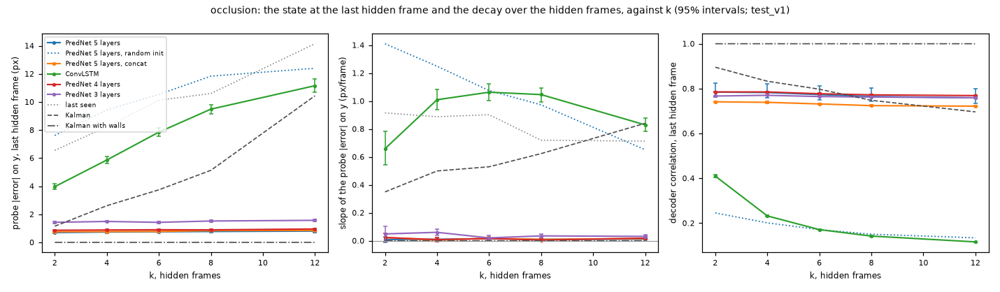

Occlusion sequences of `test_v1`, against k: the probe error on y at the last hidden frame (left), its slope over the hidden frames (middle), and the decoder correlation at the last hidden frame (right), with 95% intervals.

- For the PredNets, the slopes are tiny: some are above zero (0.010 px per frame [0.005, 0.014] for 5 layers at k = 12), but that adds up to about 0.1 px over 12 hidden frames. After 12 hidden frames, the 5 layer model still reads the digit within 0.71 px, where the constant velocity filter is 10.4 px off. H1b, as stated (the error grows with the duration), does not hold for them: their memory does not fade over the durations tested.
- The ConvLSTM's error grows by about 1 px per hidden frame, about as fast as the last seen position, and its decoder falls to its random initialization level by k = 6. It is the only model for which H1b holds.

**H1a: the PredNets draw the digit as it comes out, on time and in place.** On the frames where the digit comes out (the reappearance frame and the next two):

| Model | On time | Late | Early | Ink drawn on the exit side | Drawn digit, error on y (px) | MSE over the bar region |
| --- | --- | --- | --- | --- | --- | --- |
| PredNet 5 layers | 92% | 1% | 6% | 25.5 | 0.25 | 0.00015 |
| PredNet 5 layers, concat | 90% | 1% | 9% | 25.7 | 0.29 | 0.00071 |
| PredNet 4 layers | 91% | 1% | 8% | 25.6 | 0.28 | 0.00015 |
| PredNet 3 layers | 93% | 4% | 2% | 24.6 | **0.22** | **0.00010** |
| ConvLSTM | 22% | 71% | 7% | 29.5 | 1.17 | 0.00298 |
| true frame | | | | 23.9 | | |
| copy of the last frame | 0% | 100% | 0% | 11.2 | 1.66 | 0.00171 |
| blank frame | | | | | | 0.00163 |

The timing compares the first frame with at least one pixel's worth of ink on the exit side, drawn and true. The copy of the last frame is one frame late by construction. "Early" mostly means the model crosses the threshold on the frame before, when the true digit already shows a few faint edge pixels (0.12 of ink on average).

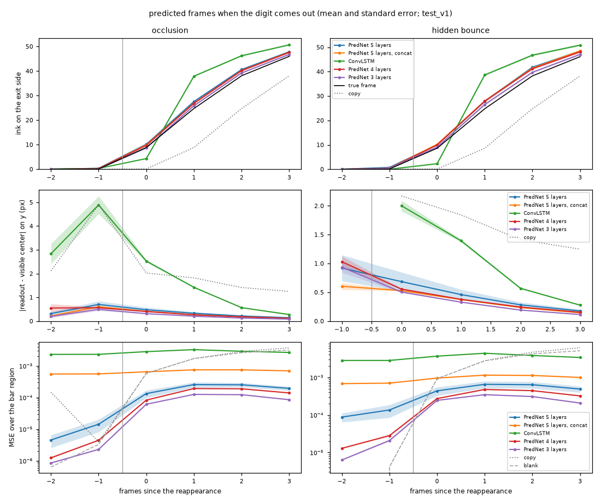

Occlusion (left) and hidden bounce (right) sequences of `test_v1`, against the frames since the reappearance: the ink drawn on the exit side of the bar (top), the error on y of the drawn digit against the visible digit (middle), and the MSE over the bar region (bottom, log scale), with the true frame, the copy of the last frame, and the blank frame.

- Every PredNet draws the edge of the digit on the frame where it comes out (9.7 pixels' worth of ink for the 5 layer model, against 8.9 on the true frame), before it has seen any of it, and in place (0.25 px in y). After a hidden bounce they do the same on the entry side (84 to 87% on time).
- The ConvLSTM behaves like the copy of the last frame: it draws almost nothing on the reappearance frame (4.3), then too much once it has seen the digit (37.9 against 24.7 on the next frame). Over the bar region, it does worse than the blank frame.
- The concat model's bar MSE is 5 times the 5 layer model's because of its red tint, not because of the digit: its timing and its drawn digit are as good.

**Limits.** One seed per model: the intervals are over test sequences, not over training runs, so differences between models of a few tenths of a pixel say how these runs differ, not how the architectures do; more seeds come in step 3.7. The emergence threshold (one pixel's worth of ink) and the window (2 frames before to 3 after) were fixed on `dev_v1`. The probe and the decoder are minimal readouts fitted on new sequences of the training stream (steps 2.8 and 2.9), so they show what the state holds in a linearly readable form, a lower bound.

**Decisions.** RQ1 is answered for this sweep: the PredNets keep the hidden digit and draw it back on time, without measurable loss up to 12 hidden frames; the ConvLSTM does not. The analyses of `test_v1` are kept in git in `runs/analysis/test_v1/`.

## Step 3.3: correction after the reappearance (RQ2)

**Question.** When the digit comes back into view, how many frames does each model need to be right again, and is it slower when the reappearance is surprising (H2)? An expected reappearance tests whether the model was ready for it; a surprising one tests how fast it gives up its expectation.

**Setup.** The five sweep models (one seed each) on `test_v1`, from the passes of step 3.1 (`scripts/analyze_correction.py`, about a minute; `runs/analysis/test_v1/correction/`). Everything is aligned on the actual reappearance frame (j = 0, the first frame with visible ink). Expected reappearances: the 5600 occlusion and 2400 hidden bounce sequences of the cells. Surprising ones: the impossible member of each surprise tuple (600 per kind, 200 for the speed kinds) against the possible member that ends with exactly the same frames: AB against B, so the difference comes from the history alone. For `vanish`, AB never reappears; its BA, where the digit appears from nowhere, is compared with A. Three readouts, each with its references:

- the state: the distance of the position probe to the true center, against the Kalman filters;
- the predicted frame: the distance of the drawn digit (its ink centroid off the bar) to the visible ink center (critique C9), against the copy of the last frame;
- the pixels: the MSE in the box around the digit.

The latency (decision D14) is the first frame from which the error stays at or below a threshold tau for 2 frames in a row, within the first 6 frames after the reappearance; a sequence that never gets there is censored and counts as 5 frames. Tau is each model's own precision on visible frames: the 90% quantile of its error on the fully visible frames before the onset of the cells (from frame 2 on), at least 3 px for the two distances. It is 3 px for the probes of PredNet 5 layers and concat, 3.49 for 4 layers, 4.8 for 3 layers, and 11.2 for the ConvLSTM, and 3 px for every drawn digit (4.47 for the copy). A latency therefore says how fast a model gets back to its own usual precision: the ConvLSTM's probe is never precise, so its latency is short by construction, and the mean error over the 6 frames is the measure to compare between models. Between 0.2 and 5.8% of the sequences, depending on the event, end their analysis window before the latency can be read and are left out.

All the choices were fixed on `dev_v1` and committed before `test_v1` was run. A check on `dev_v1` showed that the ConvLSTM's large tau is its real precision, not a slow start: the 90% quantile of its probe error stays between 10 and 12 px at every frame of the sequence.

**Expected reappearances: the PredNets are right at once.**

| Model | Probe latency, occlusion | Probe latency, hidden bounce | Drawn digit latency, occlusion | Drawn digit latency, hidden bounce |
| --- | --- | --- | --- | --- |
| PredNet 5 layers | **0.06** | **0.36** | 0.02 | 0.03 |
| PredNet 5 layers, concat | 0.12 | 0.70 | 0.02 | 0.03 |
| PredNet 4 layers | 0.13 | 0.62 | **0.01** | 0.04 |
| PredNet 3 layers | 0.16 | 0.70 | 0.04 | 0.06 |
| ConvLSTM | 0.65 | 0.70 | 0.93 | 0.99 |
| copy of the last frame | | | 0.92 | 0.95 |
| Kalman, constant velocity | 1.31 (22% censored) | 4.54 (66% censored) | | |
| Kalman with walls | 0.00 | 0.00 | | |

The PredNets draw the digit where it comes out and keep it in their state through the reappearance. The ConvLSTM draws it one frame late, exactly as the copy of the last frame does. The constant velocity filter needs several frames, since its detector only sees the digit once it is fully out of the bar; after a hidden bounce it is not back within 6 frames in two thirds of the sequences.

**Surprising reappearances: the PredNets need 1 to 3 frames to draw the digit in its new place, the ConvLSTM is not affected.** Latency of the drawn digit, AB minus B on the same frames (95% intervals):

| Model | direction | offset | early | speed fast | speed slow | appear (vanish BA - A) |
| --- | --- | --- | --- | --- | --- | --- |
| PredNet 5 layers | 2.74 [2.63, 2.86] | 2.29 [2.23, 2.35] | 1.25 [1.20, 1.30] | 1.19 [1.09, 1.28] | 1.54 [1.39, 1.70] | 1.06 [1.01, 1.10] |
| PredNet 5 layers, concat | 2.62 [2.52, 2.72] | 2.19 [2.13, 2.25] | 1.30 [1.25, 1.34] | 1.16 [1.06, 1.26] | 1.16 [1.03, 1.29] | 1.16 [1.12, 1.20] |
| PredNet 4 layers | 2.75 [2.64, 2.86] | 2.06 [1.99, 2.13] | 1.08 [1.04, 1.13] | 1.18 [1.08, 1.27] | 1.09 [0.97, 1.22] | 1.05 [1.01, 1.09] |
| PredNet 3 layers | 2.61 [2.49, 2.73] | **1.90** [1.82, 1.96] | **0.96** [0.92, 1.01] | 1.10 [1.04, 1.17] | **0.80** [0.70, 0.90] | 1.01 [0.96, 1.05] |
| ConvLSTM | 0.01 [-0.01, 0.03] | 0.04 [0.02, 0.05] | 0.00 [-0.02, 0.01] | 0.08 [0.04, 0.12] | 0.00 [0.00, 0.00] | 0.01 [-0.01, 0.02] |

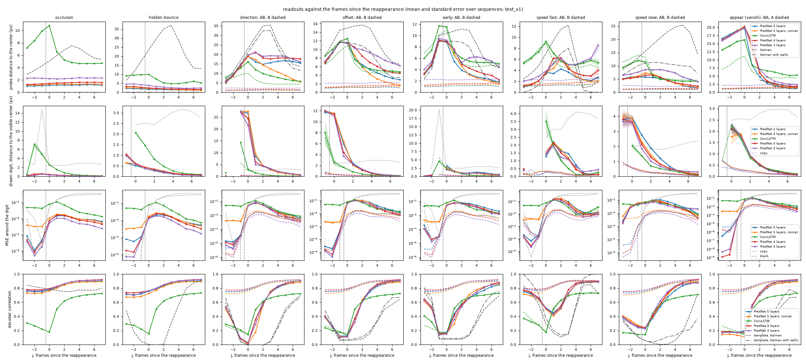

`test_v1`: the probe's distance to the center, the drawn digit's distance to the visible center, the MSE around the digit (log scale), and the decoder correlation, against j, the frames since the reappearance. One column per event; for the tuples, the surprising member (solid) and its matched control on the same frames (dashed). References in gray: Kalman filters, copy of the last frame, blank frame, and the templates.

- After a `direction` surprise (the digit comes back out on its entry side, with no wall to explain it), the 5 layer model first draws the digit on the side it expected: 26.7 px from the visible digit on the reappearance frame, 8.6 px on the next, 3.3 px two frames later, against 0.15 to 0.35 px on B. `offset` (12 px higher or lower) takes about 2 frames, the timing surprises (`early`, the two speed changes) and `appear` about 1. The error of the drawn digit over the 6 frames is 5.65 px above B's after `direction` and 3.50 px after `offset` (5 layers).
- The pixels follow: the MSE around the digit stays above the model's usual level 1.5 to 3.7 frames longer than on B.
- The ConvLSTM draws the same frames whatever the history (AB - B within 0.08 frames and 0.04 px): with nothing expected, nothing surprises it. Its frames are those of a copy, late by one frame in both members.
- The 3 layer model corrects its drawing fastest, by a few tenths of a frame; with one seed per model, this is a difference between these runs.

**The probe's reading of the state stays on the old trajectory.** Mean probe error over the 6 frames, AB minus B (px, 95% intervals):

| Model | direction | offset | early | speed fast | speed slow | appear (vanish BA - A) |
| --- | --- | --- | --- | --- | --- | --- |
| PredNet 5 layers | 15.30 [14.84, 15.79] | 5.42 [5.28, 5.56] | 3.30 [3.15, 3.45] | 2.07 [1.93, 2.22] | 3.43 [3.13, 3.74] | 5.48 [5.33, 5.64] |
| PredNet 5 layers, concat | 12.57 [12.12, 13.01] | 4.74 [4.63, 4.86] | 3.38 [3.24, 3.52] | 2.56 [2.38, 2.74] | 3.76 [3.51, 4.02] | 6.66 [6.47, 6.85] |
| PredNet 4 layers | 17.30 [16.84, 17.77] | 6.61 [6.41, 6.80] | 3.94 [3.77, 4.11] | 2.76 [2.55, 2.97] | 3.58 [3.35, 3.82] | 6.91 [6.71, 7.10] |
| PredNet 3 layers | 17.37 [16.84, 17.95] | 7.33 [7.09, 7.58] | 4.45 [4.22, 4.70] | 2.88 [2.64, 3.11] | 5.54 [5.03, 6.10] | 6.58 [6.37, 6.80] |
| ConvLSTM | 4.53 [4.21, 4.84] | 0.95 [0.71, 1.17] | 0.75 [0.59, 0.92] | 0.77 [0.51, 1.02] | -0.68 [-0.97, -0.40] | 2.37 [2.06, 2.67] |
| Kalman, constant velocity | 22.09 [21.26, 22.92] | 9.13 [8.15, 10.08] | 4.89 [4.38, 5.38] | 5.82 [5.11, 6.59] | 6.78 [4.08, 9.18] | -1.76 [-2.68, -0.94] |
| Kalman with walls | 25.49 [24.79, 26.20] | 9.24 [9.04, 9.43] | 7.26 [7.03, 7.50] | 4.76 [4.56, 4.97] | 10.77 [10.38, 11.16] | 2.44 [2.34, 2.53] |

- After `direction`, the probe of the 5 layer model is 19 px from the digit on the reappearance frame and still 15.5 px seven frames later, when the digit is fully visible and drawn in the right place; on B, which shows exactly the same frames, it reads 1.0 to 1.2 px. 94% of the AB sequences are not back within 6 frames, against none of B's. After `offset`, 70% are not.
- The decoder, which reads the digit's image rather than a single position, recovers with the drawing: its correlation goes from 0.02 at the reappearance to 0.74 three frames later and 0.89 at j = 7, against 0.91 on B.
- So the model redraws the digit within a few frames, but the part of its state that the linear probe reads (fitted on ordinary sequences, where position and history agree) keeps following the expected trajectory. Whether this is an old belief kept in the deep layers or a readout that mixes position with velocity is a question for step 3.5, which reads the state layer by layer.
- The Kalman filters are the slowest: they keep their prediction until the digit is fully out of the bar. The filter with walls, exact on possible motion, is misled the most by an impossible one.

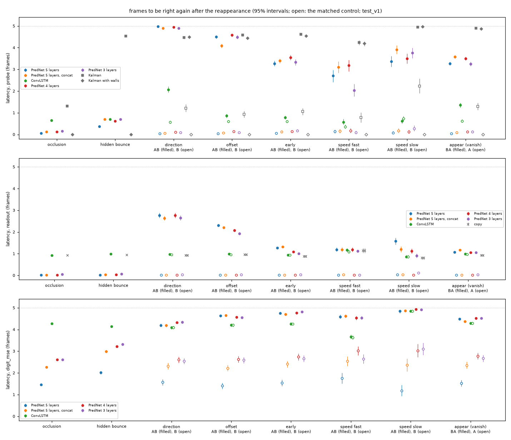

`test_v1`: the restricted mean latency (frames to be back within the model's own visible precision for 2 frames, censored at 5) of the probe (top), the drawn digit (middle), and the MSE around the digit (bottom), per event; filled: the reappearance of a cell or the surprising member of a tuple, open: its matched control; with 95% intervals.

**H2 holds for every PredNet, and not for the ConvLSTM.** On identical frames, a surprising history makes the PredNets slower to draw the digit (by 1 to 3 frames), to match its pixels, and much slower to update the probe's reading of their state. The same look without the surprise is no problem: after a hidden bounce, where the digit also comes back out on its entry side but a wall explains it, the 5 layer model's probe is back within 0.36 frames and reads 1.7 px on the reappearance frame. The ConvLSTM, which does not track the hidden digit (step 3.2), is not slowed down by a surprising history in what it draws; only its probe reads a few px more after `direction` (4.5 px) and `appear` (2.4 px).

**Limits.** One seed per model. The latency is relative to each model's own precision, and censored after 6 frames because the analysis windows end soon after the digit leaves the bar: for the probe after `direction` and `offset`, the curves and the mean error say more than the latency. The probe and the decoder were fitted on ordinary sequences; a surprising history may take the state where a linear readout was never fitted, which step 3.5 tests.

**Decisions.** RQ2 is answered for this sweep. Step 3.4 measures the surprise itself, in the prediction errors right after the reappearance (AB against B, with AUROC), and the key contrast between `direction` and the hidden bounce. Step 3.5 should read the state of the AB sequences layer by layer, to see where the old trajectory is kept.

## Step 3.4: surprise (RQ3)

**Question.** Are the prediction errors larger after a surprising event than after a matched plausible one, and can they tell the two apart (H3)?

**Setup.** The five sweep models (one seed each) on `test_v1`, from the passes of step 3.1 (`scripts/analyze_surprise.py`, about 5 minutes; `runs/analysis/test_v1/surprise/`). Each surprise tuple (600 per kind, 200 for the speed kinds) gives the controlled comparison of PLATO: the impossible member AB and the possible member B show exactly the same frames from the splice on, so any difference comes from the history alone; BA against A is the mirror. For `vanish`, AB is the digit that never comes back and B the same scene without a digit.

The signal is read over 5 frames from the first frame where AB departs from what its history announces: the earlier of the reappearances of A (expected by AB's history) and B (shown by AB). This is the actual reappearance when the digit comes early or on time, and the expected one when it comes late or never. The window length is the default of the protocol, committed before `test_v1` was run; `dev_v1` gives the same picture and changed nothing.

Three measures per tuple: the surprise index (the window mean of AB minus that of B, with a bootstrap interval over tuples), the AUROC (with a paired bootstrap interval), and the share of tuples where AB is higher. The copy of the last frame and the blank frame are the check: they see the same frames in AB and B, and their index is exactly 0 on every kind, as it must be.

**Every PredNet is surprised on identical frames, and the ConvLSTM is not.** Next frame MSE on the whole frame, AB minus B (x 10⁻⁴, 95% intervals):

| Model | direction | offset | early | speed fast | speed slow | vanish | AUROC | Tuples with AB higher |
| --- | --- | --- | --- | --- | --- | --- | --- | --- |
| PredNet 5 layers | 4.68 [4.53, 4.85] | 6.24 [6.02, 6.47] | 3.98 [3.83, 4.13] | 6.38 [6.12, 6.64] | 5.64 [5.32, 6.01] | 3.15 [3.05, 3.26] | 0.995 to 1.00 | 99.7 to 100% |
| PredNet 5 layers, concat | 4.36 [4.23, 4.50] | 5.74 [5.55, 5.94] | 3.41 [3.29, 3.54] | 6.05 [5.80, 6.29] | 5.15 [4.84, 5.48] | 3.55 [3.44, 3.67] | 0.92 to 1.00 | 99.8 to 100% |
| PredNet 4 layers | 4.29 [4.16, 4.44] | 5.03 [4.87, 5.20] | 3.34 [3.21, 3.47] | 5.08 [4.87, 5.30] | 4.40 [4.18, 4.64] | 2.54 [2.47, 2.62] | 0.99 to 1.00 | 100% |
| PredNet 3 layers | 4.47 [4.33, 4.61] | 5.38 [5.15, 5.60] | 3.51 [3.38, 3.63] | 4.49 [4.32, 4.66] | 3.95 [3.75, 4.17] | 2.41 [2.33, 2.49] | 0.997 to 1.00 | 99.8 to 100% |
| ConvLSTM | -0.03 [-0.05, -0.01] | 0.07 [0.05, 0.08] | 0.04 [0.03, 0.05] | 0.31 [0.24, 0.38] | 0.03 [0.02, 0.05] | 0.00 [0.00, 0.00] | 0.50 to 0.53 | 44 to 71% |
| Copy of the last frame | 0 | 0 | 0 | 0 | 0 | 0 | 0.50 | none (ties) |

- The mirror BA - A gives the same picture: an index of 2.6 to 7.1 x 10⁻⁴ for the PredNets, with an AUROC of 0.99 to 1.00 for 3, 4, and 5 layers and 0.87 to 1.00 for concat. The MSE over the bar region tells the same story, with larger values.
- With an AUROC at the ceiling, the models cannot be ranked by it; the index can tell them apart, but with one seed per model, those differences are between these runs.
- The concat model has about the same index as the 5 layer model, and a lower AUROC: its error has a floor of 3.6 x 10⁻⁴ on frames where 5 layers has 4 x 10⁻⁶, so the same rise stands out less between tuples. In a PredNet, passing the errors on explicitly is not what makes the surprise appear.
- The ConvLSTM is not simply hidden by its floor (1.5 x 10⁻³): its index itself is at least 15 times smaller than the PredNets'. The largest is 0.31 x 10⁻⁴ on `speed_fast`, small but distinct from 0. A model that does not keep the hidden digit (step 3.2) has almost no expectation to violate.
- In the 5 layer model, the index grows with the digit's speed on every kind with several speeds (`direction`: 3.50, 4.76, and 5.79 x 10⁻⁴ at 2, 3, and 4 px per frame), which may simply be because a faster digit leaves more pixels wrong. It is still there after 8 hidden frames: lower than after 4 for `direction` (4.19 against 5.18 x 10⁻⁴), `early`, and the speed kinds, unchanged for `offset` and `vanish`.

**The surprise appears even when nothing in the image changes.** In the 5 layer model:

| Frames since the window start | -1 | 0 | 1 | 2 | 3 | 4 | 5 | 7 |
| --- | --- | --- | --- | --- | --- | --- | --- | --- |
| `vanish`, AB (x 10⁻⁵) | 0.87 | 37 | 57 | 38 | 19 | 8.9 | 4.0 | 0.67 |
| `vanish`, B, the same frames (x 10⁻⁵) | 0.39 | 0.39 | 0.39 | 0.39 | 0.39 | 0.39 | 0.39 | 0.39 |
| `vanish`, copy (x 10⁻⁵) | 0 | 0 | 0 | 0 | 0 | 0 | 0 | 0 |
| `direction`, AB (x 10⁻⁵) | 0.73 | 35 | 80 | 75 | 49 | 31 | 22 | 13 |
| `direction`, B, the same frames (x 10⁻⁵) | 0.53 | 3.1 | 7.7 | 9.3 | 8.4 | 7.2 | 6.5 | 6.6 |

- After `vanish`, the frames do not change at all (the copy's error is exactly 0), and on the same frames with no digit in the history the error stays flat. With the digit in its history, the error rises about 150 fold around the frame where the digit should come back, and fades over about 7 frames: the error is the model's expectation alone, an omission response.
- After `speed_slow`, the same at the expected frame, where the digit has not come yet: 52 x 10⁻⁵ on AB against 0.54 x 10⁻⁵ on B, with a copy at 0.07 x 10⁻⁵.
- After `direction`, the peak is about 10 times B's on the same frames, and the excess is still there at the end of the window: the 5 frames catch the peak, not the whole response.
- This fits step 3.3: the PredNets take a few frames to redraw the digit in its true place. On the probe side, step 3.3 already gives the answer: the probe's reading does not jump to the new place at the reappearance, it stays on the old trajectory.

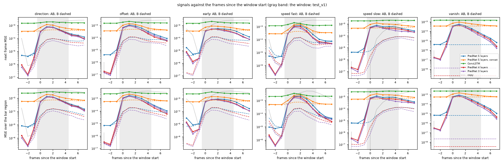

`test_v1`, log scale: the next frame MSE on the whole frame (top) and over the bar region (bottom) against the frames since the window start (shaded), per surprise kind; solid: the impossible member AB, dashed: the possible member B, which shows the same frames from the splice on; dotted: the copy of the last frame.

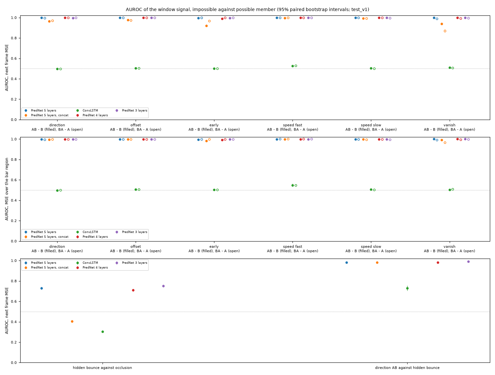

`test_v1`: the AUROC of the window mean of the whole frame MSE (top) and of the MSE over the bar region (middle), per surprise kind and model; filled: AB against B, open: BA against A; the key contrast (bottom), unpaired; with 95% intervals.

**The same look, explained by a wall (C13).** A digit that comes back out on its entry side is impossible without a wall (`direction`) and expected with one (the hidden bounce cells). These are different frames, so this comparison is unpaired and less controlled than AB against B. Whole frame MSE over the 5 frames from the reappearance, with the unpaired AUROC:

| Model | Occlusion | Hidden bounce | `direction` AB | Hidden bounce vs occlusion | `direction` AB vs hidden bounce |
| --- | --- | --- | --- | --- | --- |
| PredNet 5 layers | 0.88 x 10⁻⁴ | 1.35 x 10⁻⁴ | 5.40 x 10⁻⁴ | 0.73 [0.72, 0.74] | 0.98 [0.98, 0.99] |
| PredNet 5 layers, concat | 4.37 x 10⁻⁴ | 3.84 x 10⁻⁴ | 8.67 x 10⁻⁴ | 0.40 [0.39, 0.42] | 0.98 [0.98, 0.99] |
| PredNet 4 layers | 0.85 x 10⁻⁴ | 1.28 x 10⁻⁴ | 4.99 x 10⁻⁴ | 0.71 [0.70, 0.72] | 0.98 [0.98, 0.99] |
| PredNet 3 layers | 0.55 x 10⁻⁴ | 0.92 x 10⁻⁴ | 4.92 x 10⁻⁴ | 0.75 [0.74, 0.76] | 0.99 [0.99, 0.99] |
| ConvLSTM | 17.6 x 10⁻⁴ | 13.8 x 10⁻⁴ | 17.6 x 10⁻⁴ | 0.30 [0.29, 0.32] | 0.73 [0.71, 0.75] |
| Copy of the last frame | 15.7 x 10⁻⁴ | 15.9 x 10⁻⁴ | 12.0 x 10⁻⁴ | 0.51 [0.50, 0.52] | 0.35 [0.32, 0.38] |

- For the 3, 4, and 5 layer PredNets, a hidden bounce costs about 1.5 times the error of an ordinary occlusion, and the same return without a wall about 6 to 9 times, although its frames are easier for the copy. A wall makes the same look far less surprising, which suggests that these models use where the bar stands. The concat model also separates `direction` from the hidden bounce, with a smaller ratio (2.3).
- Whether the 1.5 fold rise after a hidden bounce is a small surprise or harder frames cannot be told here: the frames differ.
- The AUROC alone would overstate this contrast: the ConvLSTM also gets 0.73 for `direction` AB against the hidden bounce, without any surprise of its own, because its error is lower on the hidden bounce scenes (13.8 against 17.6 x 10⁻⁴ for occlusion). The same goes for the MSE over the bar region, where the frames differ the most (hidden bounce against occlusion: 0.80 for the copy, 0.89 for the ConvLSTM, 0.91 to 0.93 for the PredNets), so that signal is not used for this contrast.

**The error units respond at every layer, in different proportions.** The AUROC per layer alone is misleading here. It ranks all the AB against all the B, so it also falls when the activity of a layer varies between tuples more than AB and B differ. Layer 1 of the 5 layer model has an AUROC of 0.60 on `direction`, and AB is higher in 100% of the tuples: its error rises only 4%, but consistently, on a large baseline. So a layer's low AUROC means a small rise, not an absent one. PredNet 5 layers, AB against B, whole frame:

| Layer | Rise on `direction`, one frame into the window | Share of tuples with AB higher: direction | offset | early | speed fast | speed slow | vanish | AUROC: direction | vanish |
| --- | --- | --- | --- | --- | --- | --- | --- | --- | --- |
| 0 | x 3.5 | 100% | 100% | 99.7% | 100% | 100% | 100% | 0.99 | 1.00 |
| 1 | + 4% | 100% | 100% | 100% | 99.5% | 100% | 100% | 0.60 | 0.58 |
| 2 | + 7% | 99.7% | 100% | 100% | 64.5% | 100% | 100% | 0.70 | 0.88 |
| 3 | + 43% | 94.7% | 100% | 100% | 100% | 83.0% | 100% | 0.91 | 1.00 |
| 4 | + 72% | 93.0% | 93.8% | 100% | 100% | 74.0% | 100% | 0.89 | 1.00 |

- Layer 0 follows the pixels, as expected. The rise is largest there and in the deepest layers, so the surprise is not only a pixel mismatch: it reaches the top of the hierarchy, where the errors compare representations.
- The kinds differ in depth for 5 layers: `speed_slow`, where nothing has appeared yet in the window's first frames, is weakest in layers 3 and 4; `speed_fast` is weakest in layer 2. A fixed window hides any difference in timing between layers, so this is only a lead for step 3.5.
- On `vanish`, AB is higher in 100% of the tuples at every layer of every model.

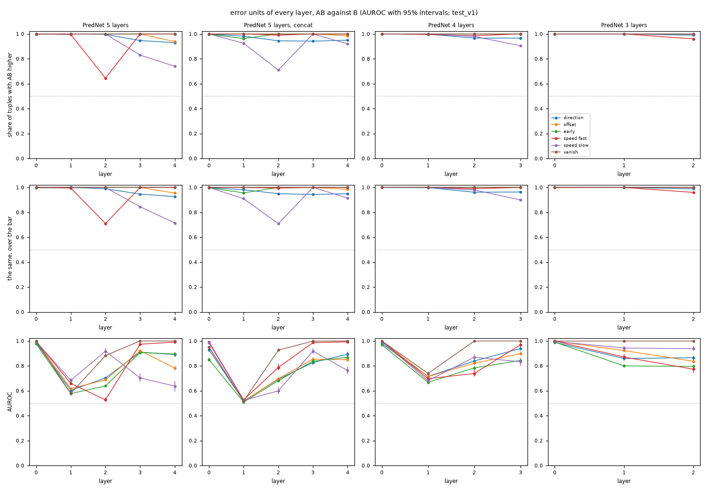

`test_v1`: for each model with error units (the concat model computes them without passing them on), AB against B per layer: the share of tuples with AB higher, on the whole frame (top) and over the bar (middle), and the AUROC on the whole frame (bottom), with 95% intervals; one line per surprise kind.

**H3 holds for every PredNet, with or without explicit error units, and not for the ConvLSTM.** On identical frames, a surprising history raises the prediction error in nearly every tuple, and the error alone tells AB from B almost perfectly. The strongest evidence is `vanish`: an error about 150 times larger with nothing in the image to cause it.

**Limits.** One seed per model, and the intervals are over tuples: they say nothing about the spread between trainings. The AUROC is at its ceiling, so it does not rank models or kinds. The surprise index is in units of each signal: values of different layers cannot be compared directly. The window is fixed and ends before the response does on most kinds. The hidden bounce contrast is unpaired. The choice to show the share of tuples in the layer figure and the printed table came after reading the `test_v1` output; the share was already saved in `index.csv`, and no number changed.

**Decisions.** RQ3 is answered for this sweep. Step 3.5 reads the state and the error units layer by layer over time, which can test the differences in timing that this fixed window hides.

## Step 3.5: inside the state

**Question.** Which layers of the state hold the hidden digit, and do they code it as they code a visible one? After a surprise, which layers keep the expectation? What do the error units of each layer do while the digit is hidden and when it comes back?

**Setup.** The five sweep models (one seed each) on `test_v1`. `scripts/fit_layers.py` fits the readouts again on subsets of the layers of the state R, on the same training stream frames as steps 2.8 and 2.9 (6 to 9 minutes per run). There are four kinds of subsets: all the layers, every layer alone, every layer but one, and all the layers fitted on the fully visible frames only. The probes are the ridge probes of (y, x), and the decoders are the minimal decoder of step 2.9. A second, lighter pass of each model over the set reads every readout on every frame (`scripts/extract.py --layers`, about 5 h for the five models), and `scripts/analyze_layers.py` reads it with the passes of step 3.1 (about a minute; `runs/analysis/test_v1/layers/`). The probe on all the layers is the probe of step 3.1: the largest difference is 8 x 10⁻⁶ px. The intervals are 95% bootstraps over sequences (5600 occlusion and 2400 hidden bounce sequences) or over tuples. Every choice was fixed on `dev_v1` and committed before `test_v1` was run, and `dev_v1` gives the same numbers within 0.2 px.

**A probe that never saw a hidden digit still finds it.** On the fully hidden frames of the occlusion sequences:

| Model | Probe error on y, fitted on every frame | Fitted on visible frames only | Difference | Decoder correlation, every frame | Visible frames only |
| --- | --- | --- | --- | --- | --- |
| PredNet 5 layers | **0.64 px** [0.63, 0.65] | **1.12 px** [1.10, 1.14] | +0.48 [0.46, 0.50] | 0.76 | **0.73** |
| PredNet 5 layers, concat | 0.76 px [0.74, 0.77] | 1.37 px [1.34, 1.40] | +0.61 [0.59, 0.64] | 0.73 | 0.55 |
| PredNet 4 layers | 0.86 px [0.84, 0.87] | 1.58 px [1.55, 1.62] | +0.72 [0.69, 0.75] | 0.78 | 0.68 |
| PredNet 3 layers | 1.46 px [1.44, 1.49] | 3.17 px [3.09, 3.24] | +1.70 [1.64, 1.77] | 0.76 | 0.40 |
| ConvLSTM | 5.13 px [5.03, 5.22] | 9.10 px [8.95, 9.25] | +3.97 [3.82, 4.13] | 0.31 | -0.03 |
| constant velocity Kalman filter | 2.38 px [2.21, 2.54] | | | | |

- The main limit of the probe of step 2.8 was that it saw hidden frames in training. A probe fitted on visible frames only still reads the hidden digit of the 5 layer model within 1.1 px, twice as precisely as the Kalman filter, and its decoder loses only 0.02 of correlation. In that model, the state codes a hidden digit almost as it codes a visible one.
- The code drifts a little while the digit is hidden. Over 8 hidden frames, the error of the visible frames probe rises from 0.7 to about 1.2 px in the 5 layer model, and falls back once the digit is out. The probe fitted on every frame stays flat.
- The fewer the layers, the further the hidden code moves away from the visible one. The 3 layer model holds the hidden digit as well as the others (1.46 px when the probe sees hidden frames), but a probe of visible digits reads it 3.2 px off, worse than the Kalman filter, and its decoder falls to 0.40.
- The ConvLSTM's visible frames decoder is at chance on hidden frames.

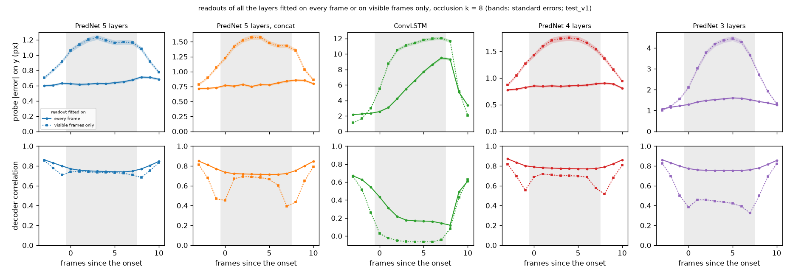

`test_v1`, occlusion with k = 8: the probe error on y (top) and the decoder correlation (bottom) of the readouts of all the layers, fitted on every frame (solid) or on the fully visible frames only (dotted), against the frames since the onset (hidden frames shaded); bands: standard errors.

**The hidden digit is in the upper layers, held redundantly.** Each layer alone, on the fully hidden frames of the occlusion sequences (probe error on y in px / decoder correlation):

| Model | Layer 0 | Layer 1 | Layer 2 | Layer 3 | Layer 4 | All the layers |
| --- | --- | --- | --- | --- | --- | --- |
| PredNet 5 layers | 10.74 / 0.18 | 2.68 / 0.56 | 1.24 / **0.76** | **0.88** / 0.52 | 0.95 / 0.36 | 0.64 / 0.76 |
| PredNet 5 layers, concat | 8.15 / 0.15 | 3.55 / 0.23 | 1.22 / **0.74** | **0.98** / 0.59 | 1.14 / 0.39 | 0.76 / 0.73 |
| PredNet 4 layers | 12.00 / 0.17 | 1.93 / 0.75 | 1.24 / **0.77** | **1.19** / 0.54 | | 0.86 / 0.78 |
| PredNet 3 layers | 9.80 / 0.17 | 3.39 / 0.32 | **1.53** / **0.76** | | | 1.46 / 0.76 |
| ConvLSTM | 6.65 / 0.27 | 5.88 / 0.27 | 5.54 / 0.18 | 6.26 / 0.09 | | 5.13 / 0.31 |

- Layer 0 loses the hidden digit: alone, it reads it 8 to 12 px off, worse than the Kalman filter (2.4 px), although it gives 3 to 5 px on visible frames.
- The position is read best from the deepest layers: layer 3 alone of the 5 layer model is within 0.9 px. The shape is read best from the middle: layer 2 alone gives as good a decoder as all the layers.
- No layer is needed on its own in the 4 and 5 layer models. Without any one layer, the probe of the 5 layer model loses at most 0.12 px [0.11, 0.12] (without layer 4), and its decoder at most 0.12 of correlation (without layer 2). The 3 layer model is the exception: without its top layer, its probe reads 3.30 px off (+1.84 [1.78, 1.90]) and its decoder falls to 0.31.
- The ConvLSTM holds the hidden digit in none of its layers.

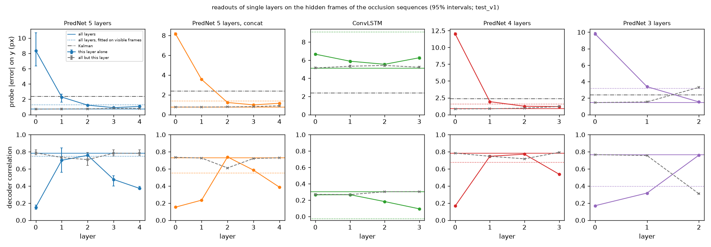

`test_v1`, fully hidden frames of the occlusion sequences: the probe error on y (top) and the decoder correlation (bottom) of every layer alone (colored) and of all the layers but this one (gray), against the layer, with all the layers (solid line), all the layers fitted on visible frames only (dotted), and the Kalman filter (dash dot); 95% intervals.

**After a surprise, the expectation is kept above the pixel layer.** The probe's distance to the true center over the 6 frames after each member's reappearance, the impossible member minus the possible one on the same tuples (in px; for `vanish`, the digit that appears from nowhere, BA - A). In the 5 layer model:

| Kind | All the layers | Fitted on visible frames only | Layer 0 alone | Layers 1 to 4 alone | Kalman filter |
| --- | --- | --- | --- | --- | --- |
| `direction` | 15.30 [14.84, 15.79] | 14.38 | 3.31 | 12.34 to 16.39 | 22.09 |
| `offset` | 5.42 [5.28, 5.56] | 4.82 | 1.52 | 4.82 to 6.26 | 9.13 |
| `early` | 3.30 [3.15, 3.45] | 3.26 | 2.27 | 3.25 to 4.11 | 4.89 |
| `speed_fast` | 2.07 [1.93, 2.22] | 1.87 | 2.62 | 2.07 to 2.95 | 5.82 |
| `speed_slow` | 3.43 [3.13, 3.74] | 3.00 | 0.57 | 3.04 to 5.99 | 6.78 |
| `vanish` (BA - A) | 5.48 [5.33, 5.64] | 5.11 | 1.32 | 3.50 to 6.14 | -1.76 |

- Step 3.3 found that the probe stays on the old trajectory for several frames after a surprise, while the drawn digit recovers. This lag lives above the pixel layer. Layer 0 alone mostly follows the input: after `direction`, it is 3.3 px further on AB than on B, against 12 to 16 px for every layer above. Every PredNet shows the same pattern (after `direction`: 12.6 to 17.4 px on all the layers, 3.3 to 7.2 px on layer 0 alone). The exception is `speed_fast`, where layer 0 lags as much as the others.
- The readouts fitted on visible frames only lag almost as much (14.4 against 15.3 px after `direction`), so the lag is not an artifact of a probe trained on hidden digits.
- The decoders tell the same story: on the impossible member, the correlation of all the layers is 0.18 to 0.32 lower for every PredNet, and that of layer 0 alone only 0.05 to 0.12 lower. The ConvLSTM's decoder correlation differs by 0.01 at most: it draws what it sees, whatever the history.
- The ConvLSTM's probe on all the layers lags 4.5 px after `direction`, and its probe fitted on visible frames 0.2 px. Whatever its state keeps of the history is not coded as a visible digit.

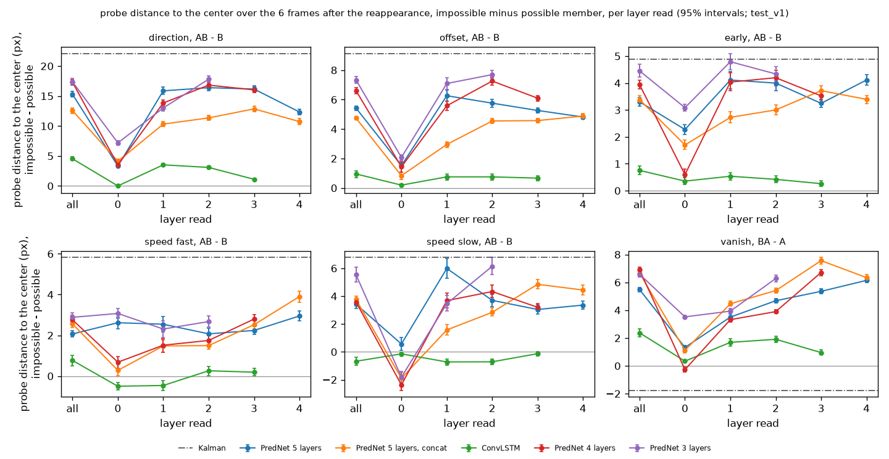

`test_v1`: the probe's distance to the true center over the 6 frames after the reappearance, the impossible member minus the possible one on the same tuples, for all the layers and every layer alone, per surprise kind and model, with the Kalman filter (dash dot); 95% intervals over tuples.

**The pixel layer's errors go quiet under the bar, and the top layer responds to a hidden bounce.** The error units of every PredNet layer, relative to their level on the visible frames before the onset (1 = the same): their mean over the hidden frames and over the reappearance frame and the next two.

| Model | Layer 0, hidden, whole frame | Layer 0, reappearance, bar | Upper layers, hidden, whole frame | Top layer over the bar, hidden bounce at k = 8: frame 2 / peak at frame 3 or 4 |
| --- | --- | --- | --- | --- |
| PredNet 5 layers | 0.27 | 1.21 | 0.89 to 0.97 | 1.36 / **2.12** |
| PredNet 5 layers, concat | 0.75 | 1.17 | 0.73 to 1.01 | 1.28 / **2.66** |
| PredNet 4 layers | 0.27 | 2.08 | 0.92 to 0.95 | 1.51 / **1.89** |
| PredNet 3 layers | 0.31 | 2.32 | 0.91 to 0.93 | 1.16 / **1.41** |

- During an occlusion, the errors of layer 0 fall to about a quarter of their visible level: the frames under the bar do not change, and the model predicts them. They rise again when the digit comes out, most over the bar (1.2 to 2.3 times their visible level). The concat model, whose error units are computed but not passed on, falls less (0.75).
- The upper layers stay within about 10% of their visible level for the whole occlusion (the concat model's top layer: 0.73), and near it at the reappearance. Holding a hidden digit costs no error activity: the digit is kept in the state R, and the errors are quiet.
- After a hidden bounce, the top layer's errors over the bar peak at frame 3 or 4 of 8, in the middle of the hidden frames, where the hidden digit bounces off the wall. They rise 1.2 to 2.1 times their level at frame 2, in every PredNet. Layer 0 shows no peak there in the 5 layer models, and a smaller one a frame later in the 3 and 4 layer models (1.47 and 1.26 at frame 4). The top of the hierarchy responds to an event that is not in the image, as the error of step 3.4 rose after `vanish`. This is a mean over sequences of one seed per model: a lead, not a result.

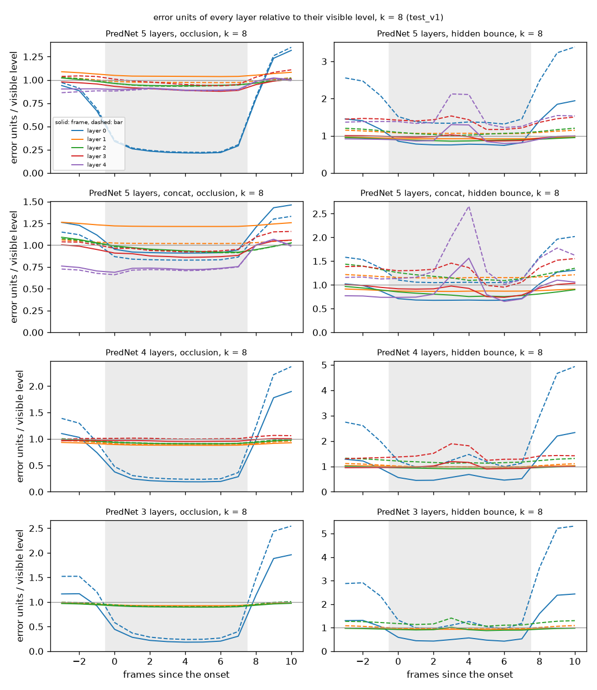

`test_v1`, k = 8: the error units of every PredNet layer relative to their level on the visible frames before the onset, on the whole frame (solid) and over the bar (dashed), against the frames since the onset (hidden frames shaded), for occlusion (left) and hidden bounce (right).

`scripts/show_errors.py` draws the maps of these error units frame by frame, for one sequence or the four members of a surprise tuple, as figures and GIFs (`<run>/errors/`, kept local).

**Limits.** One seed per model: seeds 1 and 2 of the 5 layer model come in step 3.7. The readouts are linear. A layer that a linear readout does not read may still hold the digit in another form, and the layers do not give the readouts the same number of features (768 to 1536 per layer after pooling). The error units are relative to the visible frames before the onset of both cells together, so the hidden bounce scenes, where the bar stands against a wall, start above 1. The timing of the error units of every layer after a surprise is not measured here: the curves are drawn for the cells only, and the maps of `show_errors` show single tuples.

**Decisions.** The hidden digit of the 4 and 5 layer PredNets is held in their upper layers, coded nearly as a visible digit, and with redundancy, while their error units stay quiet. Step 3.6 removes the input (blackout) and feeds the models their own predictions (closed loop).

## Step 3.6: blackout and closed loop

**Question.** Does the state keep the digit when the input disappears, rather than being hidden by an occluder (D13)? Does the model keep it when it runs on its own predictions (C10), and does it then draw the digit in the right place, on the pixels themselves (H1a)? Is it ready when the input comes back?

**Setup.** The five sweep models (one seed each) on `test_v1`, over the 1800 blackout sequences (k in {2, 4, 8} at speeds 2, 3, and 4, 600 sequences per k) and the 5600 occlusion sequences. During a blackout, every frame is black, the bar included, a case never seen in training. `scripts/extract.py --closed-loop` runs each model twice over these sequences. The first run is in open loop, as in the other steps. The second is in closed loop: from the onset to the reappearance, the model reads its own prediction of each frame in place of the frame. Both runs are scored against the frames drawn without the blackout. The passes take 6 to 11 minutes per model on the blackout cells and 18 to 33 minutes on the occlusion cells (2 h 36 in all). `scripts/analyze_closed_loop.py` reads them with the trackers of the set in 20 s (`runs/analysis/test_v1/closed_loop/`). The measures:
- the probe and the decoder of steps 2.8 and 2.9;
- the drawn digit's error on y: the ink centroid off the bar of the predicted frame against that of the frame without the blackout, with the share of frames where a digit is drawn;
- the MSE in the box around the digit.

On the hidden frames of the occlusion cells, the frame without the blackout shows no digit off the bar, so the drawn digit is read there only from the reappearance on. The intervals are 95% bootstraps over sequences, and closed minus open loop is paired on the same sequences. Every choice was fixed on `dev_v1` and committed before `test_v1` was run, and `dev_v1` gives the same numbers within 0.6 px for the PredNets and 0.9 px for the ConvLSTM.

**Without input, the state loses the digit (D13).** Probe error on y in open loop (px), on the blackout frames and on the hidden frames of the occlusion cells with the same k:

| Model | Blackout, k = 2 | k = 4 | k = 8 | Occlusion, k = 2 | k = 4 | k = 8 |
| --- | --- | --- | --- | --- | --- | --- |
| PredNet 5 layers | 4.76 | 7.49 | 9.76 | **0.64** | **0.63** | **0.63** |
| PredNet 5 layers, concat | **1.03** | **3.06** | **7.17** | 0.75 | 0.76 | 0.78 |
| PredNet 4 layers | 2.48 | 7.02 | 9.82 | 0.85 | 0.86 | 0.86 |
| PredNet 3 layers | 4.62 | 7.56 | 9.18 | 1.40 | 1.45 | 1.50 |
| ConvLSTM | 6.44 | 7.45 | 8.64 | 3.64 | 4.24 | 5.97 |
| constant velocity Kalman filter | 0.89 | 1.19 | 1.99 | 0.97 | 1.82 | 2.64 |
| last seen position | 5.16 | 6.05 | 7.95 | 6.09 | 6.91 | 8.25 |

- A single black frame is enough. At k = 8, the 5 layer model's probe goes from 0.66 px on the first blackout frame (predicted from visible frames) to 9.4 px on the next, and stays near 12 px. Over the blackout frames it is 7.3 px off, further than the last seen position (6.4 px): the state does not freeze the digit, it moves away from it. The decoder correlation falls from 0.82 to about 0 within four frames.
- The same models keep the digit under the bar with no loss over 12 frames (step 3.2). The memory of a hidden digit depends on seeing what hides it: a bar explains why the digit is not seen, a black frame is taken as evidence that it is gone.
- The model without explicit error units (concat) loses it slowly: 1.3 px after one black frame, 6.2 px after three, 12.8 px after seven. While it still draws a digit, the digit is in place (0.91 px), but it draws one on fewer and fewer frames (67% of the blackout frames).

**On its own predictions, PredNet carries the digit through the blackout, on the pixels (C10, H1a).** On the blackout frames, in open and closed loop:

| Model | Probe error on y, open | Closed | Closed - open [95%] | Drawn digit error on y, open (share drawn) | Closed | Decoder correlation, open | Closed |
| --- | --- | --- | --- | --- | --- | --- | --- |
| PredNet 5 layers | 7.34 px | **0.67 px** | -6.67 [-6.89, -6.45] | 6.41 px (100%) | 0.18 px | 0.46 | 0.84 |
| PredNet 5 layers, concat | 3.76 px | 0.76 px | -3.00 [-3.17, -2.84] | 0.91 px (67%) | 0.22 px | 0.62 | 0.83 |
| PredNet 4 layers | 6.44 px | 0.86 px | -5.57 [-5.80, -5.37] | 4.76 px (86%) | 0.22 px | 0.48 | **0.85** |
| PredNet 3 layers | 7.12 px | 1.37 px | -5.75 [-5.96, -5.56] | 4.66 px (58%) | **0.15 px** | 0.45 | **0.85** |
| ConvLSTM | 7.51 px | 8.84 px | +1.33 [+1.04, +1.62] | 8.53 px (55%) | 9.45 px | 0.29 | 0.50 |
| constant velocity Kalman filter | 1.35 px | | | | | | |
| last seen position | 6.39 px | | | | | | |

- In closed loop, every PredNet keeps the digit for the whole blackout. At k = 8, the 5 layer model's probe stays between 0.64 and 0.73 px over the 8 frames, while the Kalman filter, with no input either, drifts to 3.9 px by the last blackout frame. The models draw a digit on every blackout frame, on average 0.15 to 0.22 px from where it is in the frame without the blackout (at most 0.30 px on any frame at k = 8): the model tracks the digit on its pixels, not only in a readout of its state.
- The input comes back to a model that is ready. Over the reappearance frame and the next two, the 5 layer model's probe is 0.72 px off in closed loop, against 7.91 px in open loop (Kalman 1.72 px), and its drawn digit 0.12 px, against 5.54 px.
- The ConvLSTM gets worse in closed loop. Its probe goes from 3.3 px at the onset to 17 px after 8 frames, and 17 px over the return frames (9.4 px in open loop). Its errors compound when it reads its own predictions.

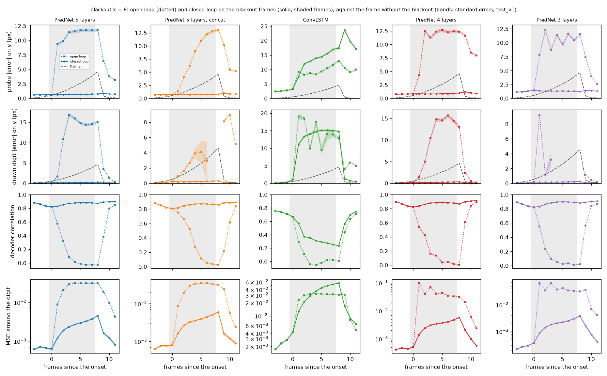

`test_v1`, blackout with k = 8: the probe error on y, the drawn digit error on y, the decoder correlation, and the MSE around the digit, in open loop (dotted) and in closed loop over the blackout frames (solid, shaded frames), against the frames since the onset, with the Kalman filter (dashed); bands: standard errors. A dotted line with gaps marks frames where no digit is drawn in most sequences.

**Under the bar, PredNet's own predictions are as good as the input.** On the hidden frames of the occlusion cells, closed minus open loop is at most 0.005 px for the probe of every PredNet, and at most 0.044 px over the return frames: the predicted frames are the true frames (MSE around the digit about 10⁻⁶ in the middle of the occlusion for the 3 to 5 layer models), so reading them changes nothing. The ConvLSTM again breaks down: +4.36 px [4.22, 4.50] on the hidden frames, +9.56 px [9.32, 9.80] over the return frames, and its drawn digit is 7.31 px off at the return, against 1.16 px in open loop.

**Limits.** One seed per model: seeds 1 and 2 of the 5 layer model come in step 3.7. In closed loop, the model reads frames that show a digit, so for the model a blackout becomes an ordinary visible sequence. The closed loop therefore tests whether the model's own dynamics carry the digit over 2 to 8 frames, not whether the state holds it without input; that is the open loop's question. The closed loop feeds the model its prediction of frame t in place of frame t; the original PredNet code fed the prediction one step earlier, so its closed loop numbers are not comparable. The drawn digit is read as an ink centroid off the bar, and in open loop only on the frames where a digit is drawn, so it is read next to the share of frames drawn. The trackers are scored against the true center, the drawn digit against the ink of the frame without the blackout.

**Decisions.** In open loop, the PredNets keep a hidden digit only when an occluder explains why it is not seen: a missing input erases it, after a single black frame in the 5 layer model and within a few frames in the concat model. Their learned dynamics, however, carry the digit precisely when they run on their own predictions, through a blackout and under the bar alike, and the ConvLSTM's do not. Step 3.7 trains seeds 1 and 2 of the 5 layer model, and step 3.8 gathers the results.
