# Experiments

The lab notebook of the project: each training experiment, what it showed, and the decisions it led to, in the order they were run. How the code works is in [implementation.md](implementation.md), and the commands that reproduce each run are in [usage.md](usage.md).

## Step 2.4: pilot training of PredNet 5 layers

**First pilot: PredNet's own loss fails.** PredNet 5 layers, 10k steps of 16 sequences of 40 frames (`configs/train/pilot_prednet5l.yaml`). The loss fell below the plateau where only the bar is known, but from step 3500 on the validation MSE stayed at 0.00149, the MSE of the blank frame (the true frame with its digit erased, 0.00148). The learning rate drop at step 5000 did not change it. The prediction figures show a perfect bar and background, and no digit at all. On the visible moving frames of `val_v1`, the MSE was 0.00205 against 0.00205 for the blank frame and 0.00263 for the copy: the gate D16 failed.

The cause is the sparsity of the digit in the loss. The red digit covers about 1.2% of the pixels, on one channel out of three, so about 0.4% of the loss values, against about 7% in the usual Moving MNIST (two white 28 px digits on 64 x 64 frames), where PredNet learns to draw digits. With an L1 loss, a pixel that is unlikely to hold ink is best predicted empty: as long as the model cannot place the digit to the pixel, erasing it costs less than drawing it, and the model settled there.

**Two fixes, tried for 2000 steps each** (`scripts/trial_pilots.py`, same initialization and training sequences, constant learning rate):

| Variant | Validation MSE at step 2000 | Blank frame | Below the blank frame |
| --- | --- | --- | --- |
| first pilot, for comparison | 0.00161 | 0.00148 | -9% (then 0%) |
| white digit (three channels), PredNet's own loss | 0.00446 | 0.00444 | -0.5% |
| red digit, visible digit pixels weighted by 10 | 0.00063 | 0.00148 | +57% (13%, 40%, 51%, 57% at steps 500 to 2000) |

A white digit, three times heavier in the loss, still settled on the blank solution. The weighted loss drew the digit within 500 steps, sharp and in the right place, and after only 2000 steps passed the gate D16 by far: on the visible moving frames, an MSE 72% below the blank frame and 78% below the copy, at every speed, in every condition, and for every k (59% below the blank frame at k = 12). The drawn digit is slightly thicker than the true one, as expected when missing ink costs ten times more than extra ink.

**Decision (D12).** Every learned model trains with the visible digit pixels weighted by 10 (`loss.digit_weight: 10`). The weight changes only the training objective, uses only ink visible in the target frame, and gives no information about a hidden digit.

**Full pilot with the weighted loss: the gate passes by far.** Same settings as the first pilot, with the digit weight of 10 (`configs/train/pilot_prednet5l_w10.yaml`, 10k steps, about 5 h 30 on an Apple M5). On the visible moving frames of `val_v1`, the best checkpoint (step 10000) has an MSE of 0.00010, 95% below the blank frame (0.00205) and 96% below the copy (0.00263), with an SSIM of 0.999. The reduction against the blank frame is between 94% and 96% in every condition, at every speed, and for every k, so PredNet does not fall back to copying on fast digits.

| Step | 500 | 1000 | 2000 | 3000 | 4000 | 4500 | 5000 | 6000 | 8000 | 10000 |
| --- | --- | --- | --- | --- | --- | --- | --- | --- | --- | --- |
| Validation MSE (all frames, blank frame 0.00148) | 0.00129 | 0.00089 | 0.00063 | 0.00053 | 0.00038 | 0.00017 | 0.00016 | 0.00014 | 0.00014 | 0.00013 |

The validation MSE fell by half between steps 4000 and 4500, a sudden change in what the model had learned, 500 steps before the learning rate drop. After the drop, it improved only slowly. With another seed or another model, such a change could come after the drop, and much later with a learning rate ten times smaller: the training sweep (step 2.10) should therefore keep the high learning rate longer, for example 15k steps with the drop at 10k, and check that every run has passed this change before its drop.

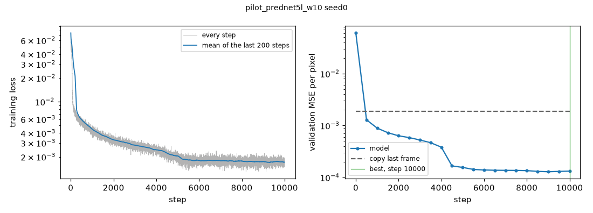

Training loss and validation MSE of the weighted pilot, against copying the last frame.

The prediction figures show the digit drawn sharp and in place on every visible frame, and nothing under the bar, which is the correct prediction of the next frame there. Two examples already point at tracking. In an occlusion sequence, the model draws the part of the digit that comes out at the edge of the bar in the first frame of the reappearance, from frames in which the digit was fully hidden. In a hidden bounce sequence, it draws the digit coming back out on the side it entered, at about the right time. Phase 3 measures this on the whole test set.

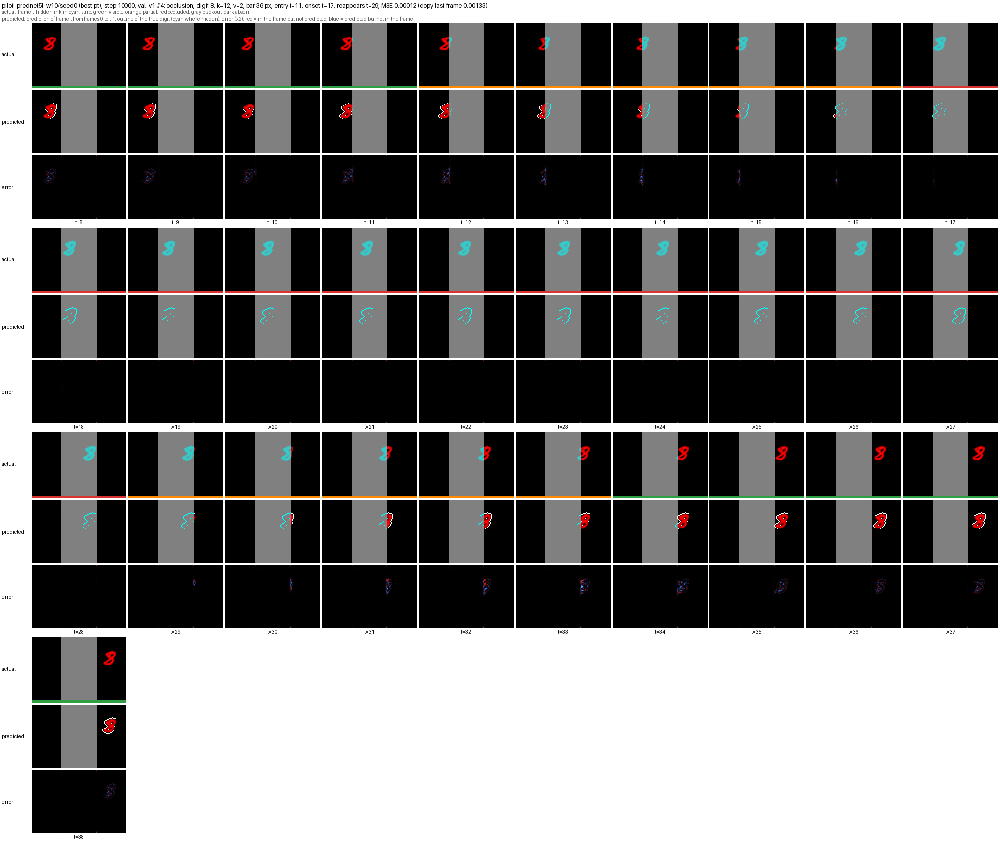

Frames around a crossing of `val_v1`: the true frame (hidden ink in cyan), the prediction with the outline of the true digit, and the pixel error (red: missed, blue: extra).

The run is kept in git as the reference result of step 2.4: `runs/pilot_prednet5l_w10/` (settings, logs, curves, `best.pt`, evaluation, and prediction figures) and its output `runs/pilot_prednet5l_w10.log`.

## Step 2.8: position probe on the pilot model

**Question.** While the digit is fully hidden, the correct next frame shows only the bar, so the predicted frames cannot tell whether PredNet still knows where the digit is. The position probe reads it in the model's internal state instead (option B, decision D15): a linear readout of the centroid from the pooled states R, fitted on the frozen pilot model (`runs/pilot_prednet5l_w10`, step 10000).

**Setup** (`scripts/fit_probes.py`, about 9 minutes). Features: the five layers of R, average pooled to 5,760 values per frame. Probes fitted on the analysis windows of 800 new sequences of the training stream (20,059 frames, hidden frames included), penalties chosen on held out training sequences (ridge alpha 100, logistic C 0.01). Evaluation on the 1000 sequences of `val_v1`, digits never seen in training. Controls: the same probe on the same architecture at random initialization, the programmed trackers of step 2.7, and the bar center for x.

**Result: the state keeps the hidden digit's position almost as precisely as a visible one.** Mean absolute error in pixels on the fully hidden frames of the analysis window (y is the main axis, critique C4):

| Method | occlusion, y | occlusion, x | hidden bounce, y | hidden bounce, x |
| --- | --- | --- | --- | --- |
| probe of the trained PredNet | **0.60** | **0.59** | **0.81** | **1.37** |
| probe of PredNet at random initialization | 9.66 | 5.08 | 9.14 | 6.25 |
| last seen position | 8.88 | 25.79 | 9.47 | 19.67 |
| Kalman, constant velocity | 3.87 | 0.12 | 3.85 | 6.68 |
| Kalman with walls (exact reference) | 0.00 | 0.00 | 0.00 | 0.00 |
| bar center | | 6.31 | | 3.34 |

- On fully hidden frames, the probe's error (0.60 px in y) equals its error on visible frames (0.68 px): hiding the digit costs the state almost no position information.
- The error stays flat over the first 15 hidden frames (figure below), while the last seen position and the constant velocity filter drift away. The state does not just hold the last position: it updates it as the digit moves behind the bar.
- After a bounce off the wall while hidden, the probe still finds the digit (1.4 px in x), where the constant velocity filter is 6.7 px off on average and about 37 px after 15 frames. The state follows the bounce.
- The probe beats the constant velocity filter even in y, where the filter is hurt by vertical bounces just before or under the bar.
- The random initialization control reads the visible digit roughly (4 to 5 px) but loses it once hidden (9 to 10 px, close to the last seen position): the position code of hidden digits comes from training, not from the architecture.
- The 8 bin probe agrees: the probability of the true bin of y is 0.87 on hidden frames of occlusions (0.25 at random initialization, 0.125 by chance).

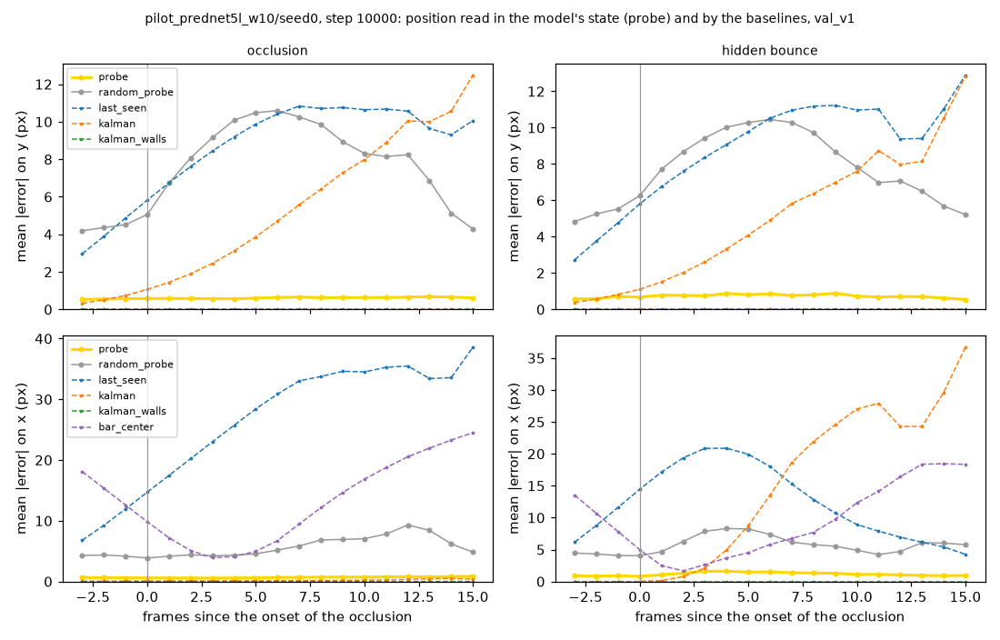

Mean absolute error on y (top) and x (bottom) against the frames since the onset of the occlusion, for occlusion (left) and hidden bounce (right) sequences of `val_v1`. The probe of the trained model (yellow) stays flat at about 0.6 px.

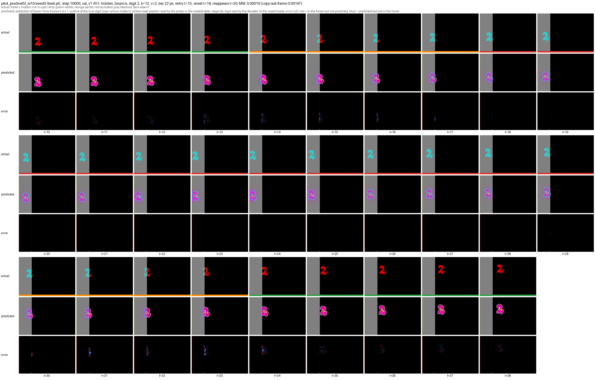

A hidden bounce of `val_v1` (k = 12, 2 px/frame): the yellow cross, where the probe reads the digit in the state, follows the hidden digit (cyan outline) to the wall and back, through 12 fully hidden frames.

**Limits.** One seed, one model, and the validation set. The probe is trained with hidden frames, so it shows that the information is in the state in a linearly readable form, not that the model uses it the same way as for visible digits. Phase 3 measures this on `test_v1` per k, speed, and condition (blackouts included), on every model of the sweep, and can test whether a probe trained on visible frames only transfers to hidden ones.

## Step 2.9: amodal decoder on the pilot model

**Question.** The position probe reads a point. Does the state also hold the hidden digit itself, its shape, at its place under the bar? The amodal decoder (option C) reads the whole digit from the frozen states: each layer's state goes through a 1 x 1 convolution, upsampled to the frame and summed, then a sigmoid, trained to output the amodal frame (the digit as if there were no bar). With 244 parameters, one per state channel, it cannot draw a digit by itself: a shape appears only where the state holds one.

**Setup** (`scripts/fit_decoder.py`, about 6 minutes). Training on 400 batches of 8 new sequences of the training stream (analysis windows, ink pixels weighted by 10). Evaluation on the 1000 sequences of `val_v1`, per frame: the ink IoU and the correlation between the decoded and the true amodal digit. Controls: the same decoder at random initialization, and the last fully visible digit copied and moved by the constant velocity Kalman filter (`template_kalman`) or by the exact filter with walls (`template_walls`, the ceiling).

**Result: the state holds a blurred but well placed image of the hidden digit.** Mean scores on the analysis window:

| Method | occlusion, IoU | occlusion, correlation | hidden bounce, IoU | hidden bounce, correlation |
| --- | --- | --- | --- | --- |
| decoder, fully hidden frames | **0.42** | **0.74** | **0.41** | **0.70** |
| decoder, visible frames (its own ceiling) | 0.63 | 0.88 | 0.66 | 0.89 |
| decoder at random initialization, hidden | 0.00 | 0.16 | 0.00 | 0.20 |
| template moved at constant velocity, hidden | 0.73 | 0.81 | 0.44 | 0.55 |
| template moved with walls (exact), hidden | 1.00 | 1.00 | 1.00 | 1.00 |

- The minimal decoder cannot reproduce even a visible digit sharply (IoU 0.63): its 1 x 1 readout of states that are coarse in the upper layers gives a blurred digit. On fully hidden frames it keeps about two thirds of that (IoU 0.42, correlation 0.74 against 0.88): a digit shaped blob at the right place, which the figures show as a magenta glow inside the cyan outline under the bar.
- At random initialization, the same decoder finds nothing under the bar (IoU 0.00): the hidden digit in the state comes from training.
- When the motion is constant, a template with the exact shape moved at constant velocity does better (IoU 0.73): the decoder's limit is the sharpness of the readout, not the place. After a bounce while hidden, the constant velocity template goes the wrong way (correlation 0.55, down to 0.1 about 7 frames after the onset) while the decoder stays at 0.70: the imagined digit follows the bounce, as the position probe did.
- In the curves against the frames since the onset, the decoder drops at the onset (0.60 to 0.42) and rises again later. The later frames mix values of k: for short occlusions the digit is already reappearing there, so the rise does not mean the hidden digit gets sharper.

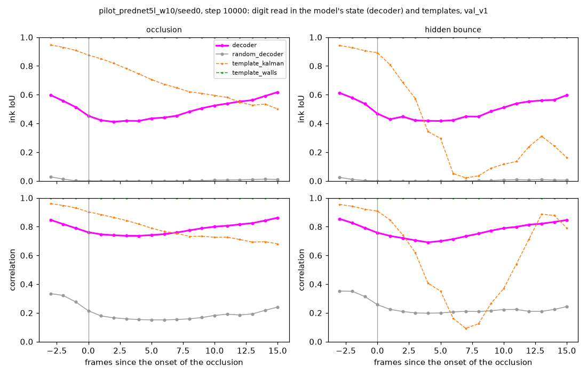

Ink IoU (top) and correlation (bottom) between the decoded and the true amodal digit against the frames since the onset of the occlusion, for occlusion (left) and hidden bounce (right) sequences of `val_v1`.

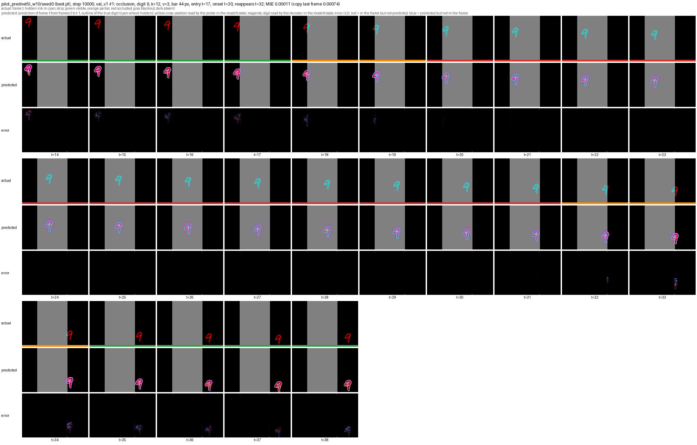

An occlusion of `val_v1` (k = 12, 3 px/frame) with both readouts on the predicted row: the yellow cross (probe) and the magenta digit (decoder) move under the bar with the true digit (cyan outline) for 12 fully hidden frames.

**Limits.** One seed and the validation set, as for the probe. The decoder is minimal on purpose, so its scores are a lower bound of what the state holds; a larger kernel (`--kernel`) would read more, but could also draw shapes by itself. The scores per k, and per layer, are left to Phase 3.

## Step 2.10: training sweep

**Question.** Does the pilot's result hold for other architectures? The sweep trains PredNet with 3, 4, and 5 layers (depth), PredNet 5 layers without explicit error units (concat: the layers pass on their states instead of their errors), and a ConvLSTM without any predictive coding structure, all at about 3.1 million parameters (within 10% of each other).

**Setup.** Five configs identical except for the model (`configs/train/sweep_*.yaml`): seed 0, 15k steps of 16 sequences of 40 frames, visible digit pixels weighted by 10, Adam at 0.001 divided by 10 at step 10000 (so that the sudden change of the pilot has time to happen before the drop), gradient norm clipped at 1.0, validation on the whole `val_v1` every 500 steps. One run at a time on an Apple M5, followed with `scripts/sweep.py`, each followed by the gate D16, the position probes, the amodal decoder, and the figures. Training took about 87 h: 7.4 h for 5 layers, 7.6 h for concat, 14.7 h for the ConvLSTM, 13.8 h for 4 layers (plus 14.0 h for its failed seed 0 run), and 29.1 h for 3 layers. The tables below come from `scripts/compare_sweep.py` (`runs/sweep_summary/summary.csv`).

**PredNet 4 layers with seed 0 failed, and was rerun with seed 1.** From step 100 on it stayed on the blank frame (training loss 0.0110 against 0.0087 for 5 layers), while its gradient norm shrank to 0.014. At steps 3967 to 3973 the gradient exploded (norms 3.6, then 835, then 1.3e4; there was no clipping then), and the predictions stayed black for 10k steps before a partial recovery. Its best checkpoint is the blank model of step 3500 (gate 0%, probe as at random initialization). The run is kept in `runs/sweep_prednet4l/seed0/` as a record. Gradient clipping at 1.0 was then added to every sweep config: the norm never exceeded 0.31 in the three runs already trained (5 layers, concat, ConvLSTM), so the clip would not have changed them, and they were not retrained (their saved `config.yaml` says `grad_clip: null`). PredNet 4 layers was rerun with seed 1, and the 4 and 3 layer runs were checked at step 1000: their validation MSE was 67% and 77% below the blank frame (at least 25% required).

**Two later loss spikes recovered by themselves.** In PredNet 4 layers seed 1, the training loss rose from 0.0014 to 0.008 between steps 9300 and 9313 and the validation MSE doubled at step 9500, back to its level by step 10000. In PredNet 3 layers, the same happened at step 6705, back by step 7500. In the 4 layer run the gradient norm stayed below 0.25 during the spike, and the clip never acted in the whole run (largest norm 0.73, at step 27); in the 3 layer run it acted once, at the spike (norm 1.77). These are not gradient explosions. The likely cause is Adam itself: when the gradients become very small, its normalized steps stay large. Both best checkpoints are from step 15000, after the recovery.

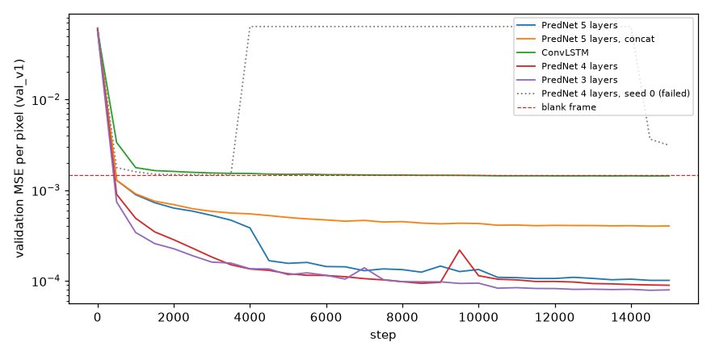

Validation MSE on `val_v1` of every sweep run against the training step, with the blank frame (dashed red) and the failed PredNet 4 layers seed 0 run (dotted).

Only the 5 layer model shows the pilot's sudden change (its validation MSE halves between steps 4000 and 4500). The 4 and 3 layer models get there smoothly, and faster: they reach the same level by step 3500.

**Next frame prediction: every PredNet passes the gate by far, the ConvLSTM barely.** Best checkpoints (step 15000, except the failed run), validation set:

| Model | Validation loss | Validation MSE (all frames) | Gate: below the blank frame (visible moving frames) | Gate at k = 12 |
| --- | --- | --- | --- | --- |
| PredNet 5 layers | 0.00141 | 0.00010 | 97% | 97% |
| PredNet 4 layers (seed 1) | 0.00119 | 0.00009 | 98% | 98% |
| PredNet 3 layers | **0.00095** | **0.00008** | **99%** | **99%** |
| PredNet 5 layers, concat | 0.00161 | 0.00040 | 85% | 74% |
| ConvLSTM | 0.00282 | 0.00144 | 42% | -1% |
| PredNet 4 layers, seed 0 (failed, step 3500) | 0.00988 | 0.00148 | 0% | 0% |
| blank frame | | 0.00148 | | |

- The three PredNet depths are within 3% of each other on the gate, at every speed, in every condition, and for every k. The shallower the model, the lower the loss: 3 layers predict the frames best, but take about 4 times longer to train than 5 layers (7.0 against 1.8 s per step).
- The 5 layer run follows the pilot (same seed and settings until the pilot's drop at step 5000) and was flat over the 2000 steps before its drop. The concat run never made the pilot's sudden change: its validation MSE stayed 4 times higher, flat from step 8500.
- The concat model draws the digit well in control sequences (94% below the blank frame) but less well in sequences with a crossing, and the longer the occlusion, the worse (90% at k = 2, 74% at k = 12). The visible frames of these sequences include those after the reappearance: without explicit errors, PredNet seems slower to pick the digit up again.
- The ConvLSTM barely leaves the blank frame (validation MSE 3% below it). It passes the gate overall only through the control sequences (79% below the blank frame); with a crossing it is 15% below in occlusion sequences, and no better than the blank frame at k = 12 (-1%). It draws a moving digit, but loses it once it has gone behind the bar.

**Readouts: every PredNet keeps the hidden digit, the ConvLSTM does not.** Analysis windows of `val_v1`, fully hidden frames unless marked visible; errors in px:

| Model | Probe y, occlusion | Probe y, visible | Probe x, occlusion | Probe x, hidden bounce | True y bin probability | Decoder correlation, occlusion | Decoder IoU, occlusion | Decoder correlation, hidden bounce |
| --- | --- | --- | --- | --- | --- | --- | --- | --- |
| PredNet 5 layers | **0.64** | **0.74** | **0.64** | **1.20** | **0.88** | 0.75 | 0.45 | 0.72 |
| PredNet 4 layers (seed 1) | 0.88 | 0.90 | 0.78 | 2.41 | 0.84 | **0.77** | **0.47** | **0.75** |
| PredNet 3 layers | 1.54 | 1.20 | 1.40 | 3.23 | 0.69 | 0.76 | 0.41 | 0.73 |
| PredNet 5 layers, concat | 0.76 | 0.80 | 0.65 | 1.67 | 0.87 | 0.72 | 0.42 | 0.69 |
| ConvLSTM | 6.47 | 2.48 | 3.38 | 5.87 | 0.41 | 0.22 | 0.00 | 0.25 |
| same model at random initialization | 8.9 to 10.2 | | | | 0.25 to 0.27 | 0.14 to 0.17 | 0.00 | 0.19 to 0.21 |
| last seen position | 8.88 | | 25.79 | 19.67 | | | | |
| Kalman, constant velocity (and the template it moves) | 3.87 | | 0.12 | 6.68 | | 0.81 | 0.73 | 0.55 |

- **The pilot's result holds for every PredNet.** With 3, 4, or 5 layers, with or without explicit errors, the probe finds the hidden digit within 0.6 to 1.5 px in y, better than the constant velocity filter (3.9 px), and follows a hidden bounce (1.2 to 3.2 px in x, against 6.7 px for the filter and 19.7 px for the last seen position). The decoder reads a well placed hidden digit (correlation 0.72 to 0.77) and beats the template moved at constant velocity after a hidden bounce (0.69 to 0.75 against 0.55). At random initialization, none of them holds anything under the bar.
- **Depth trades pixels for position.** Fewer layers predict the frames better, but the position is less linearly readable: 0.64, 0.88, then 1.54 px in y for 5, 4, and 3 layers. Part of it is the readout: the shallower models have fewer pooled features (5,760, 4,224, and 3,168), and their error on visible frames grows too (0.74, 0.90, 1.20 px). But hiding the digit costs the 3 layer model more: its hidden error is 1.28 times its visible error, against 0.86 and 0.98 for 5 and 4 layers. The decoder does not change with depth (0.75 to 0.77).
- **Explicit errors help the prediction more than the memory.** The concat model's state keeps the hidden digit almost as well as the 5 layer PredNet (0.76 against 0.64 px; 0.72 against 0.75 for the decoder), although it predicts the frames 4 times worse: the hidden digit is in its state, but it is slower to draw it again after the reappearance.
- **The ConvLSTM does not track the hidden digit.** Its probe reads the visible digit at 2.5 px but the hidden one at 6.5 px, between the constant velocity filter and random initialization, and its decoder finds nothing under the bar (IoU 0.00, correlation 0.22 against 0.17 at random initialization). Its states are all at 16 x 24 (4 x 4 patches), so its readouts are coarser than PredNet's, whose first layer is at full resolution; the contrast between its own visible and hidden frames does not depend on that. With one seed and 15k steps, this shows that it did not learn to track with this budget, not that it cannot.

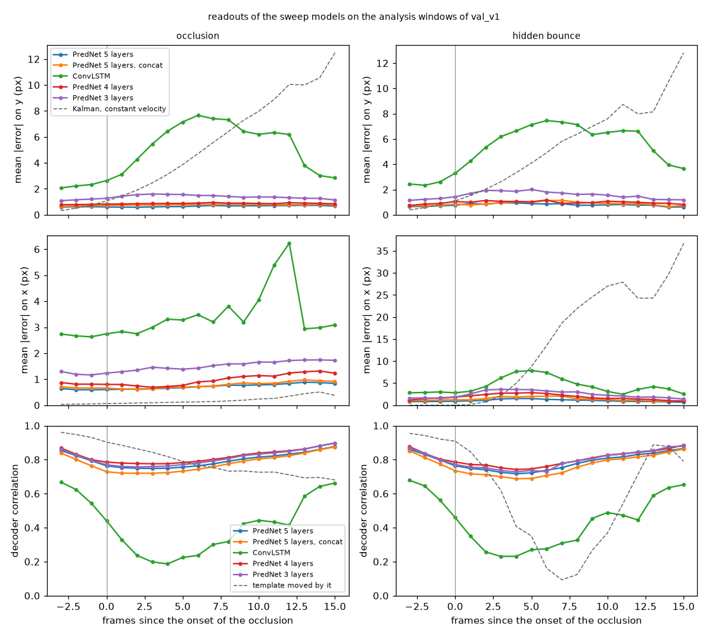

Probe error on y (top) and x (middle) and decoder correlation (bottom) against the frames since the onset of the occlusion, for occlusion (left) and hidden bounce (right) sequences of `val_v1`, one line per model, with the constant velocity Kalman filter and the template it moves (dashed gray). The later frames mix values of k: for short occlusions the digit is already reappearing there.

- Every PredNet stays flat over 15 hidden frames, in y and through hidden bounces, while the constant velocity filter drifts (12 px in y, 37 px in x after a hidden bounce). The x error of the 4 and 3 layer models grows slowly in occlusions (from 0.7 to 1.3 px and from 1.2 to 1.8 px), that of the 5 layer model much less.
- The PredNet decoders lose a little at the onset and stay near 0.75; the template moved at constant velocity starts higher but falls below them about 6 frames after the onset in occlusions, and down to 0.1 after hidden bounces.
- The ConvLSTM's error grows from the onset (from 2.6 to 7.7 px in y after 6 frames) and its decoder falls to 0.2: it forgets the digit within a few frames. Its later recovery comes from the digits that already reappear.

**Limits.** One seed per model (seed 1 for 4 layers), and the validation set: differences of a few tenths of a pixel or a few hundredths of correlation between the PredNets are not tested, and one 4 layer seed out of two failed to learn. The ConvLSTM's failure may depend on its budget. Phase 3 evaluates every model on `test_v1`: occlusion curves per k, correction after the reappearance, and surprise.

**Reference model.** PredNet 5 layers stays the reference model, shown in the README: it has the most precise readouts (best probe in every column, decoder within 0.03 of the best), it is the fastest to train (7.4 h, against 13.8 h for 4 layers and 29.1 h for 3 layers), it trained without incident with the first seed tried, and it is the architecture of Lotter et al. whose top layer sees the whole frame. The 3 layer model predicts the frames best, but the occlusion questions are about what the state holds, not about the pixels.

**Decisions.** The five models go to Phase 3 as trained here, with PredNet 4 layers seed 1 as its run of record. Gradient clipping at 1.0 stays in the configs; if more seeds are trained, a learning rate warmup or a larger Adam epsilon would address the spikes. The runs stay local (about 38 MB per checkpoint); the comparison is kept in git in `runs/sweep_summary/`.

## Step 3.2: tracking through occlusion (RQ1)

**Question.** While the digit is hidden, does each model keep it, and does it lose it faster when it stays hidden longer (H1b)? And does the model draw the digit again at the right frame and in the right place when it comes out (H1a)? A hidden digit is not to be drawn, so the predicted frames say something only when the digit comes out; what the model holds while it is hidden is read from its state, with the position probe and the amodal decoder.

**Setup.** The five sweep models (one seed each, seed 1 for 4 layers) on `test_v1`: the 5600 sequences of the occlusion cells (k = 2, 4, 6, 8, 12; the members of surprise tuples are left to RQ2 and RQ3) and the 2400 hidden bounce sequences (k = 4, 8). Each model ran once over the set (step 3.1, about 8 h for the five models), and `scripts/analyze_occlusion.py` reads the saved frames (`runs/analysis/test_v1/occlusion/`). Every value is first averaged per sequence; intervals are 95% percentile bootstraps over sequences (2000 resamples), and comparisons are paired on the same sequences. Every choice (the frames shown, the emergence window and threshold, the measures) was fixed on `dev_v1` and committed before `test_v1` was run.

One reading was fixed on `dev_v1` before that. The concat model and the ConvLSTM tint the whole gray bar slightly red on every frame (10 to 50 pixels' worth of ink), which pulled the centroid of the drawn digit toward the bar: 5 px of error even on visible frames, against 0.1 px for the PredNets. Since the bar is opaque, the true digit is never visible on it, so the centroid is now read off the bar (extraction format 2), and the five passes were written again.

**The hidden digit stays in every PredNet's state, not in the ConvLSTM's.** Hidden frames, all k together:

| Model | Probe error on y (px) | Probe error on x (px) | Decoder correlation | Probe error on y, minus the Kalman filter's |
| --- | --- | --- | --- | --- |
| PredNet 5 layers | **0.64** [0.63, 0.65] | **0.65** [0.65, 0.67] | 0.76 | **-1.74** [-1.90, -1.58] |
| PredNet 5 layers, concat | 0.76 [0.74, 0.77] | 0.70 [0.69, 0.71] | 0.73 | -1.62 [-1.78, -1.45] |
| PredNet 4 layers | 0.86 [0.84, 0.87] | 0.79 [0.78, 0.80] | **0.78** | -1.52 [-1.69, -1.35] |
| PredNet 3 layers | 1.46 [1.44, 1.49] | 1.35 [1.33, 1.37] | 0.76 | -0.92 [-1.08, -0.75] |
| ConvLSTM | 5.13 [5.03, 5.22] | 3.51 [3.46, 3.56] | 0.30 | 2.75 [2.57, 2.94] |
| same models at random initialization | 7.3 to 9.0 | | 0.17 to 0.20 | |
| last seen position | 7.77 | 21.96 | | |
| Kalman, constant velocity (and the template it moves) | 2.38 | 0.08 | 0.84 | |

Hidden bounce sequences, where the digit bounces off a wall behind the bar and comes back out on its entry side:

| Model | Probe error on y (px) | Probe error on x (px) | Decoder correlation | Decoder, minus the Kalman template |
| --- | --- | --- | --- | --- |
| PredNet 5 layers | **0.98** | **1.52** | 0.72 | +0.19 [0.18, 0.20] |
| PredNet 5 layers, concat | 1.13 | 1.88 | 0.69 | +0.16 [0.15, 0.16] |
| PredNet 4 layers | 1.23 | 2.67 | **0.75** | **+0.21** [0.21, 0.22] |
| PredNet 3 layers | 2.07 | 3.33 | 0.73 | +0.19 [0.18, 0.20] |
| ConvLSTM | 5.86 | 4.69 | 0.31 | -0.22 [-0.23, -0.21] |
| last seen position | 7.57 | 17.89 | | |
| Kalman, constant velocity (and the template it moves) | 2.55 | 4.50 | 0.54 | |

The Kalman filter with walls has no error at all (0.00 px): with exact positions and the walls known, it reproduces the motion exactly. It is the ceiling of the task, not a competitor.

- Every PredNet reads the hidden digit's vertical position within 0.6 to 1.5 px, 0.9 to 1.7 px better than the constant velocity filter, whose error comes from wall bounces just before or during the occlusion. Through a hidden bounce, they keep both axes (1.5 to 3.3 px in x, against 4.5 px for the filter and 17.9 px for the last seen position), and their decoders beat the template moved at constant velocity by about 0.2.
- In plain occlusions the template moved by the Kalman filter is still a better picture of the hidden digit (0.84 against 0.73 to 0.78): it is the true digit's own image, moved to a nearly exact position.
- The order of the sweep holds on the test set, now with intervals: against the 5 layer model, the probe error on y is 0.12 px larger for concat [0.11, 0.13], 0.22 px for 4 layers [0.20, 0.24], and 0.83 px for 3 layers [0.80, 0.85].
- The ConvLSTM's state holds less than a constant velocity filter (2.75 px worse), and its decoder is 0.11 above its own random initialization.

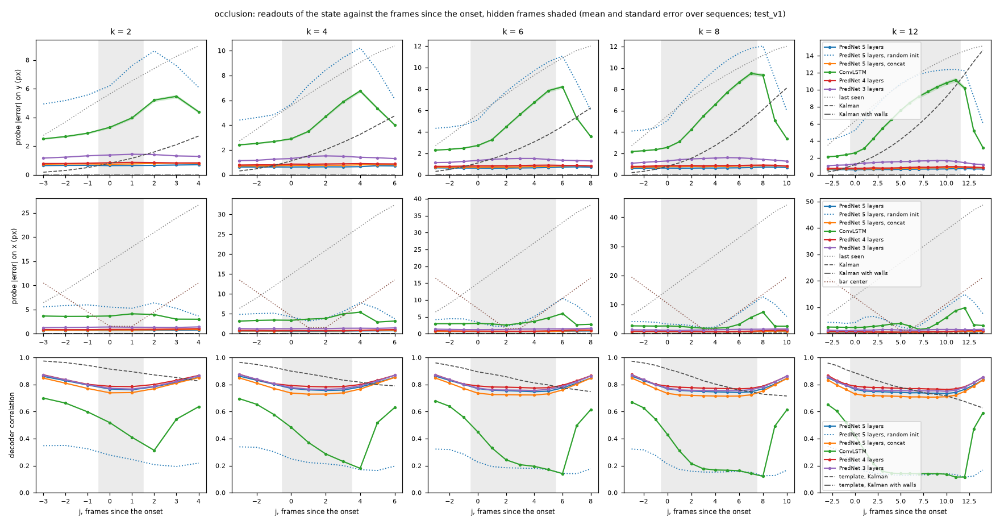

Occlusion sequences of `test_v1`: probe error on y (top) and x (middle) and decoder correlation (bottom) against j, the frames since the onset, one column per k, hidden frames shaded. Each model with its standard error band, the random initialization of the 5 layer model (dotted blue), and the references in gray: last seen position, Kalman filters, bar center, and the templates they move.

**H1b: the PredNets do not lose the digit as the occlusion lasts; the ConvLSTM loses it at once.** The slope of the probe error on y over the hidden frames, and its value at the last hidden frame:

| Model | Slope (px per hidden frame), k = 2 to 12 | Last hidden frame, k = 2 | Last hidden frame, k = 12 |
| --- | --- | --- | --- |
| PredNet 5 layers | 0.004 to 0.011 | 0.65 | **0.71** |
| PredNet 5 layers, concat | 0.004 to 0.024 | 0.76 | 0.85 |
| PredNet 4 layers | 0.005 to 0.023 | 0.86 | 0.95 |
| PredNet 3 layers | 0.020 to 0.060 | 1.43 | 1.57 |
| ConvLSTM | 0.66 to 1.06 | 3.97 | 11.16 |
| PredNet 5 layers at random initialization | 0.65 to 1.41 | 7.61 | 12.40 |
| last seen position | 0.71 to 0.92 | 6.55 | 14.14 |
| Kalman, constant velocity | 0.35 to 0.84 | 1.15 | 10.44 |

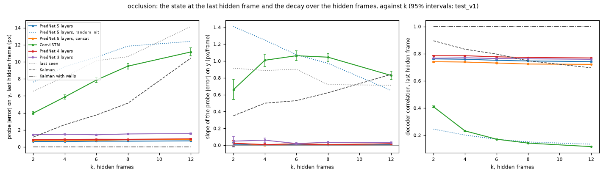

Occlusion sequences of `test_v1`, against k: the probe error on y at the last hidden frame (left), its slope over the hidden frames (middle), and the decoder correlation at the last hidden frame (right), with 95% intervals.

- For the PredNets, the slopes are tiny: some are above zero (0.010 px per frame [0.005, 0.014] for 5 layers at k = 12), but that adds up to about 0.1 px over 12 hidden frames. After 12 hidden frames, the 5 layer model still reads the digit within 0.71 px, where the constant velocity filter is 10.4 px off. H1b, as stated (the error grows with the duration), does not hold for them: their memory does not fade over the durations tested.
- The ConvLSTM's error grows by about 1 px per hidden frame, about as fast as the last seen position, and its decoder falls to its random initialization level by k = 6. It is the only model for which H1b holds.

**H1a: the PredNets draw the digit as it comes out, on time and in place.** On the frames where the digit comes out (the reappearance frame and the next two):

| Model | On time | Late | Early | Ink drawn on the exit side | Drawn digit, error on y (px) | MSE over the bar region |
| --- | --- | --- | --- | --- | --- | --- |
| PredNet 5 layers | 92% | 1% | 6% | 25.5 | 0.25 | 0.00015 |
| PredNet 5 layers, concat | 90% | 1% | 9% | 25.7 | 0.29 | 0.00071 |
| PredNet 4 layers | 91% | 1% | 8% | 25.6 | 0.28 | 0.00015 |
| PredNet 3 layers | 93% | 4% | 2% | 24.6 | **0.22** | **0.00010** |
| ConvLSTM | 22% | 71% | 7% | 29.5 | 1.17 | 0.00298 |
| true frame | | | | 23.9 | | |
| copy of the last frame | 0% | 100% | 0% | 11.2 | 1.66 | 0.00171 |
| blank frame | | | | | | 0.00163 |

The timing compares the first frame with at least one pixel's worth of ink on the exit side, drawn and true. The copy of the last frame is one frame late by construction. "Early" mostly means the model crosses the threshold on the frame before, when the true digit already shows a few faint edge pixels (0.12 of ink on average).

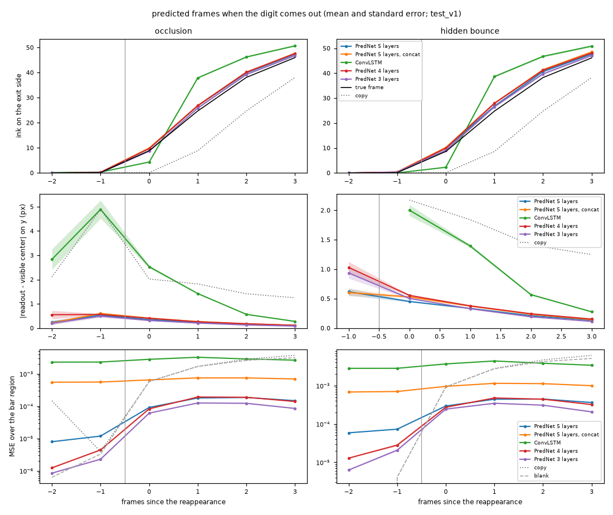

Occlusion (left) and hidden bounce (right) sequences of `test_v1`, against the frames since the reappearance: the ink drawn on the exit side of the bar (top), the error on y of the drawn digit against the visible digit (middle), and the MSE over the bar region (bottom, log scale), with the true frame, the copy of the last frame, and the blank frame.

- Every PredNet draws the edge of the digit on the frame where it comes out (9.7 pixels' worth of ink for the 5 layer model, against 8.9 on the true frame), before it has seen any of it, and in place (0.25 px in y). After a hidden bounce they do the same on the entry side (84 to 87% on time).
- The ConvLSTM behaves like the copy of the last frame: it draws almost nothing on the reappearance frame (4.3), then too much once it has seen the digit (37.9 against 24.7 on the next frame). Over the bar region, it does worse than the blank frame.
- The concat model's bar MSE is 5 times the 5 layer model's because of its red tint, not because of the digit: its timing and its drawn digit are as good.

**Limits.** One seed per model: the intervals are over test sequences, not over training runs, so differences between models of a few tenths of a pixel say how these runs differ, not how the architectures do; more seeds come in step 3.7. The emergence threshold (one pixel's worth of ink) and the window (2 frames before to 3 after) were fixed on `dev_v1`. The probe and the decoder are minimal readouts fitted on new sequences of the training stream (steps 2.8 and 2.9), so they show what the state holds in a linearly readable form, a lower bound.

**Decisions.** RQ1 is answered for this sweep: the PredNets keep the hidden digit and draw it back on time, without measurable loss up to 12 hidden frames; the ConvLSTM does not. The analyses of `test_v1` are kept in git in `runs/analysis/test_v1/`.
